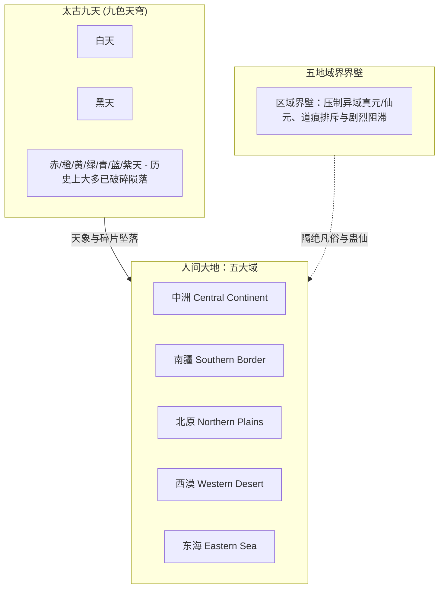
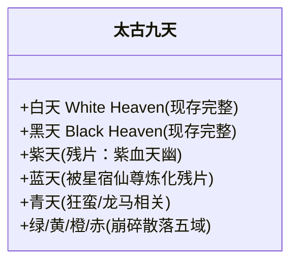

# 《蛊真人》世界观与地理格局：五域与太古九天

---

## 一、世界总体结构

《蛊真人》世界呈现出**“地分五域，天分九重”**的宏大架构。天地之间充斥着浩瀚的大道道痕（道之碎片与显化），万事万物皆由道痕构成并衍生。

---

## 二、凡间五域详述

五域之间原本被厚重粘稠的**“界壁”**阻隔。穿越界壁时，蛊师与蛊仙会承受极大的排斥、真元回流与神魂反噬，且异域蛊仙在非本域作战时，道痕会受到压制（直到大梦时代宿命蛊破灭、地脉翻涌五域界壁消散，融为大世界）。

### 1. 中洲（Central Continent）
* **地理与风貌**：地处五域核心，平原广袤，灵山福地无算，物产最为富饶，地脉最厚重，人道最为昌盛。
* **社会制度**：**门派制**。不同于其余四域的家族血脉宗族制，中洲普遍由宗门统治，阶级上升通道以招揽弟子、立功晋升为主，竞争机制成熟且善于整合资源。
* **领袖势力**：**天庭（Heavenly Court）**与**中洲十大古派**（灵蝶谷、古魂门、天莲派、灵缘斋、万龙坞、仙鹤门、战仙宗、天妒楼、风云府、黑天寺）。天庭由原始仙尊创立，历经星宿、元莲三代仙尊坐镇，是人族抗衡异人、维持天下正统三百万年不倒的圣地。
* **文化特征**：尊正道，重规矩，善集众力，擅长大规模仙阵与联合征伐。

### 2. 南疆（Southern Border）
* **地理与风貌**：十万大山，重峦叠嶂，瘴气弥漫，密林无边。山峰林立，交通闭塞，山险水恶。
* **社会制度**：**家族寨子制**。以山峰为据点，各山立山寨。凡人依附家族蛊师，蛊师以血脉宗族维系权力。
* **主要流派**：土道、木道、毒道、骨道、变换道、音道。
* **代表势力**：**武家**（南疆正道领袖，历代霸主，以强势刚烈闻名）、**商家**（商量山，善于经商贸换，包容开放）、**铁家**（铁血冷酷，擅神捕铁面、铁血楼）、**乔家**、**翼家**、**池家**（阵道世家）、**罗家**、**柴家**等。
* **开局之地**：主角方源重生起始地——古月山寨（位于青茅山，邻近白家寨、熊家寨）。

### 3. 北原（Northern Plains）
* **地理与风貌**：极度辽阔平坦的苍茫草原，风吹草低，四季分明，但周期性爆发席卷天地的**“十年大雪灾”**。
* **社会制度**：**游牧部落制与黄金血统至尊**。巨阳仙尊立下祖训，确立“黄金家族”特权，通过“王庭争霸赛”争夺进入王庭福地避难的名额，胜者通吃，弱肉强食，民风极其彪悍尚武。
* **主要流派**：力道（历史繁盛后没落）、风道、炎道、金道、运道。
* **代表势力**：
  * **长生天（Longevity Heaven）**：巨阳仙尊创立的九转洞天，北原无上圣地。
  * **黄金血脉家族**：黑家、刘家、耶律家、马家、东方家（智道传承）、努尔家等。
  * **非黄金家族与魔道**：常氏、葛家、雪胡老祖（大雪山福地，八转魔仙）。

### 4. 西漠（Western Desert）
* **地理与风貌**：浩瀚无垠的金色沙海、绿洲点缀其间，伴随恐怖的黑油地脉、沙尘暴与酷烈日照。
* **社会制度**：**绿洲家族联合制**。以绿洲为基石立足，控制水源与黑油资源。
* **主要流派**：炎道、土道、偷道、宇道、傀儡/兵道。
* **代表势力**：**房家**（擅长仙蛊屋炼制与宇道战术）、**萧家**、**石家**、**万家**、**董家**。西漠商人擅使驼队穿越沙漠，同时黑油资源是仙蛊升炼与动力核心。

### 5. 东海（Eastern Sea）
* **地理与风貌**：汪洋大海，烟波浩渺，群岛如星罗棋布，海底海沟暗藏无数上古海兽与珍稀资源。五域之中**资源总量最为丰沛**之地。
* **社会制度**：**海岛家族与散修联盟**。东海资源丰富，蛊仙斗争烈度较四域更低，性情相对温和守成，偏好贸易与坐享其成。
* **主要流派**：水道、云道、气道、食道。
* **代表势力**：宋家、华家、沈家、汤家、谢家等超级家族，以及气海老祖（方源分身）后期横扫东海、一统东海异人与散修联盟。

---

## 三、太古九天详述

太古时期，苍穹由九重天叠压而成，合称**太古九天**：
> **白、赤、橙、黄、绿、青、蓝、紫、黑**

### 1. 九天演变史与劫难
* **七天坠落**：在人祖时代到太古中古年间，太古九天历经人祖子女行迹、狂蛮魔尊毁天、红莲逆转时空等多重变故，赤天、橙天、黄天、绿天、青天、蓝天、紫天相继崩毁破碎，坠入凡间，化为诸多天之残片福地与天地绝地。
* **白天与黑天（昼夜轮转）**：最终唯有**白天**与**黑天**留存完整，二者周而复始轮转，覆盖五域长空。
* **幽天覆灭与黑天融合**：幽魂魔尊时代，曾屠戮天下，紫天碎片与黑天交织。到后期大爱仙尊（方源）时代，方源更是将两天天脉与仙窍世界大举吞并炼化。

### 2. 宝黄天（Treasure Yellow Heaven）
* **起源与性质**：太古黄天碎裂后，一名中古时期的道人（黄天道君）将黄天核心碎片与自身仙窍融合，炼制成了超然世外的**“宝黄天”**。
* **功能与地位**：
  * 全天下蛊仙最安全、最庞大的**跨域跨界自由交易市场**。
  * 宝黄天具有超强自卫天灵，不插手凡尘争霸，杜绝强抢强买。
  * 具备“宝光”机制：寄托拍卖的物品价值越高，宝光越冲霄夺目。
  * 支持神念、意志、宝光鉴宝与跨空投送（通过宝光与仙窍连接）。
  * 成为方源早期倒买倒卖、贩卖胆识蛊、兑换稀缺仙材的核心生命线。

---

## 四、界壁与地脉大势变化

1. **五域界壁特性**：
   * 中洲界壁：**圣贤界壁**（文华气象，浩然压迫）
   * 北原界壁：**苍炎界壁**（烈火炎云，焚身蚀骨）
   * 南疆界壁：**瘴气界壁**（剧毒瘴气，侵蚀真元道痕）
   * 西漠界壁：**黄沙界壁**（狂沙漫天，消磨气血）
   * 东海界壁：**蔚蓝界壁**（波涛汹涌，泥泞缠滞）

2. **五域合一历史大潮**：
   * 宿命蛊大战前后，天下地脉复苏，**地气翻涌，地沟频生**，五域界壁因地脉相通而逐渐变薄，最终彻底消融消失。
   * 界壁消失后，五域合一为混元一体的大陆，九天崩坍为“两天（黑白天）”，全天下迎来百舸争流、大爱渡劫、尊者并立的终极狂潮。

