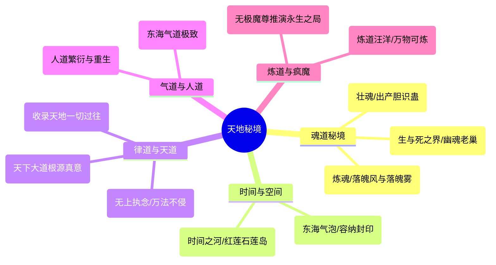

# 《蛊真人》天地秘境全览与汇考

---

## 一、天地秘境概述

天地秘境，是天地自然造化中道痕极端浓郁、规则自发具象化而形成的奇迹之地。
每一处天地秘境不仅蕴含无上天地奥秘，更在本质上**等同于准九转仙蛊**（道痕凝聚度堪比九转仙蛊）。在仙道杀招或炼蛊过程中，天地秘境往往能作为不可替代的核心基石。

---

## 二、核心天地秘境详考

### 1. 荡魂山（Dang Hun Mountain）
* **流派归属**：魂道
* **地理流转**：南疆白骨山附近 $\rightarrow$ 狐仙福地 $\rightarrow$ 方源至尊仙窍
* **外形与特征**：通体由纯净魂质与剔透晶石构成的大山，整座山泛着幽绿森然之光。
* **神异功效**：
  * **震荡神魂**：凡活物生灵登临山体，魂魄皆受山风震荡。若底蕴不足，则魂魄溃散消融。
  * **出产胆识蛊**：将活物（如毛民、异人、战俘或荒兽）魂魄砸碎在荡魂山石上，便会自然凝结出天下第一壮魂奇珍——**胆识蛊**。
  * **修行地位**：胆识蛊无视一切资质瓶颈，纯净无瑕地暴增魂魄底蕴，是方源起家、累积亿万财富与打造千万级魂魄的根基。

### 2. 落魄谷（Luo Po Valley）
* **流派归属**：魂道
* **地理流转**：中洲百年迷境 $\rightarrow$ 影宗掌握 $\rightarrow$ 方源夺得并移入至尊仙窍
* **神异功效**：
  * 谷中长年呼啸着**落魄风**（吹骨消肉，削弱肉身与魂魄杂质）与**落魄雾**（迷乱心智，消解魂魄韧性）。
  * **“荡魂山壮魂，落魄谷炼魂”**：二者合璧，乃天地魂道修行的至高圣境。荡魂山使魂魄底蕴极速膨胀，而落魄谷则将浮肿虚浮的神魂淬炼得如金刚琉璃般凝实坚韧。

### 3. 生死门（Door of Life and Death）
* **流派归属**：魂道 / 天道
* **历史渊源**：记载于《人祖传》之中，乃天下死者魂魄归宿之地。幽魂魔尊生前将其探索并移入自身掌控。
* **结构与守卫**：
  * 门外为生，门内为死。内中沉沦无尽死魂与阴气，生灵入内九死一生。
  * 藏有宿命蛊的监视规则，内含“公平蛊”等太古传说。
  * 幽魂魔尊曾以生死门为大本营，潜修数万年，研拟至尊仙胎与生死转化奥秘。

### 4. 逆流河（Reverse Flow River）
* **流派归属**：律道 / 水道
* **出现节点**：北原巨阳仙尊布局之雪胡老祖炼蛊、马鸿运事件，逆流河重现人间。
* **无上规则**：
  * **绝对禁仙**：河水之中万蛊沉寂，仙凡杀招彻底失效，唯有纯粹肉身与坚定意志能够立足。
  * **顺水则冲，逆流而上**：河水逆向奔涌，越向前阻力与冲击力呈几何级数暴增。无数英雄豪杰、八转大能入河皆被冲刷淘汰。
  * **逆流成道**：唯有方源怀揣五百年沧桑、朝闻道夕死可矣的终极执念，在绝境中咬牙徒步淌过逆流河终点，彻底征服此秘境。
* **核心杀招**：**逆流护身印**（方源将逆流河炼为杀招外衣，凡击向方源的攻击，尽数被逆流河原原本本反弹回去，凭借此招名震五域八转）。

### 5. 宙河（River of Time）
* **流派归属**：宙道（时间道）
* **世界地位**：穿梭过去、现在、未来的无形大河，万事万物皆在河水中沉浮前行。五域九天的时间流速完全由宙河支流的分支水量与流速决定。
* **奇物与遗迹**：
  * **年兽、月兽、日兽**生息繁衍之地。
  * **春秋蝉**溯流而上的唯一通道。
  * **红莲石莲岛**：红莲魔尊将自身七转、八转、九转真传深藏于宙河核心的石莲岛中，唯有春秋蝉持有者方能踏足。

### 6. 市井（City Well）
* **流派归属**：宇道 / 律道 / 人道
* **出处**：东海秘境，《人祖传》中有载。
* **神异结构**：井深幽暗，井壁悬挂无数“气泡”。每个气泡皆为一个微缩天地，能安放小福地或囚禁蛊仙，阻断内外感应，妙用无双。方源曾借市井安顿异人族群并诱杀强敌。

### 7. 乾坤晶壁（Qiankun Crystal Wall）
* **流派归属**：律道 / 智道 / 信道
* **功效**：记录天地间自太古以来所发生的一切真实历史、秘密与万事因果。盗天魔尊曾借其勘探世界壁垒；无极魔尊曾割裂部分晶壁布设于疯魔窟用于演化天道。

### 8. 疯魔窟（Crazed Demon Cave）
* **流派归属**：天道 / 律道 / 衍道
* **位置与格局**：位于北原深处，由无极魔尊耗费百万年光阴铸造。共分九层，一层比一层凶险：
  * 充斥着无序混乱的大道道痕，任何靠近的生灵都会被混乱道痕冲击神魂，沦为丧失理智的“疯魔”。
  * 第八层为无极魔尊的宏伟棋局与天地熔炉；
  * 第九层为**衍生世界中心**，无极魔尊在此推演真正的“永生之法”，也是全书各大九转尊者（星宿、巨阳、无极、幽魂、方源、乐土）巅峰终极决战之战场。

### 9. 炼海（Sea of Refinement）
* **流派归属**：炼道
* **渊源**：长毛老祖晚年竭尽心力试图人工补全天地炼道秘境，但仅成半成品；后由大爱仙尊方源融合毛民长生手段、水土万千仙材彻底完善。
* **威能**：全海由最纯净的炼道道痕凝聚成海水，万物入海皆可融炼，化天下仙材为仙蛊，是炼道尊者独步天下的终极底牌。

### 10. 原初境（Primordial Domain）
* **流派归属**：全流派万道之源
* **特征与价值**：
  * 蕴含世界诞生之初最纯粹的天地真意。
  * 蛊仙一旦吸纳原初境中对应的流派真意，便能无视万年积累，直接将自身流派境界拔升至**无上大宗师**门槛。
  * 疯魔窟大战中，各大尊者为了抢夺原初境互下死手。

---

## 三、天地秘境综合对比表

| 秘境名称 | 主修流派 | 核心功用 | 掌控者/关联尊者 | 出处/典故 |
| :--- | :--- | :--- | :--- | :--- |
| **荡魂山** | 魂道 | 产出胆识蛊，无副作用强壮神魂 | 方源（原归狐仙/影宗） | 《人祖传》落魄之祸 |
| **落魄谷** | 魂道 | 落魄风雾淬炼神魂，排除魂魄渣滓 | 方源（原归影宗） | 《人祖传》迷途篇 |
| **逆流河** | 律道/水道 | 隔绝万法，凭借心性逆流，造就防御杀招 | 方源 | 北原雪灾/逆流成仙 |
| **生死门** | 魂道/天道 | 聚集天下亡魂，执掌轮回与生死界限 | 幽魂魔尊 | 《人祖传》寻子赴死 |
| **宙河** | 宙道 | 万载光阴之源，春秋蝉游行之所 | 红莲魔尊/方源 | 天地光阴法则 |
| **市井** | 宇道/人道 | 容纳洞天福地，隔绝天机，囚禁封印 | 方源（东海所得） | 《人祖传》凡世红尘 |
| **乾坤晶壁** | 律道/智道 | 映照天地历史，记录万物真实全貌 | 盗天魔尊 / 无极魔尊 | 纪元石壁 |
| **疯魔窟** | 天道/混乱 | 瓦解理智，推演天道衍生，求索永生 | 无极魔尊 | 疯魔大阵九层世界 |
| **炼海** | 炼道 | 汪洋为火，万象炼成仙，炼蛊成尊 | 方源（继承长毛老祖） | 炼道极致造物 |
| **原初境** | 万道始源 | 储存最根本的天地真意，成尊必争之物 | 天地孕育（多尊者争夺） | 开天辟地始原 |
| **人海** | 人道 | 汲取红尘众生念力与生命，复活死者 | 方源 / 天庭 | 人道复生与香火 |
| **气海** | 气道 | 浩荡元气汇聚之海，气道仙法威能倍增 | 气海老祖（方源分身） | 东海极天之气 |
| **呼啸溪** | 音道 | 汇聚无尽音律回响，音道攻伐至宝 | 凤九歌相关 | 音道传承 |

