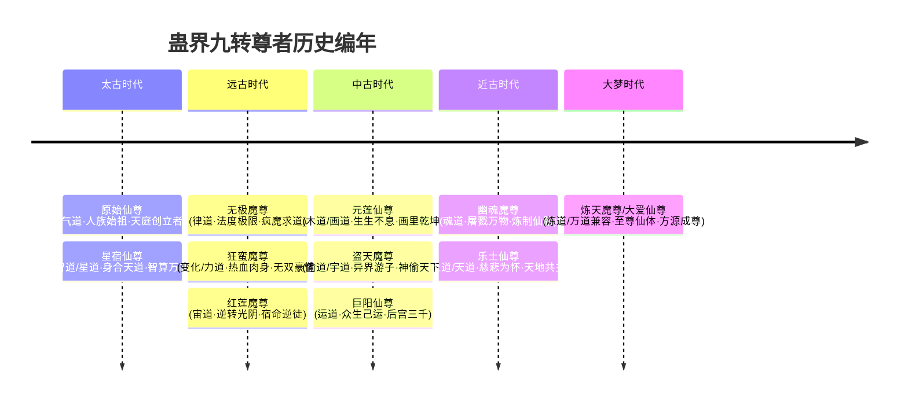

# 《蛊真人》历代九转尊者全传

---

## 一、尊者编年史总览

在蛊界数百万年的历史长河中，天地间先后诞生了**十一位九转尊者**（十位历史尊者 + 当代主角方源）。尊者在世期间举世无敌，横压一世，无一人可与之并肩，其留下的真传与谋算深远影响后世数十万乃至上百万年。

---

## 二、十一位尊者本纪与绝世风采

### 1. 原始仙尊（Primordial Origin Immortal Venerable）
* **流派**：气道
* **时代**：太古时代（人族第一位九转尊者，人族由奴隶走向统治的起点）
* **丰功伟业**：
  * 率领被异人奴役的人族崛起，开创三百万年不朽基业——**中洲天庭**。
  * 创立凡人空窍开窍法、仙凡体系，传下浩然气道。
  * 寿命极长（凭借寿蛊与气道延寿秘法），为天庭积攒了数以百万计的仙元储备。
* **名言与作风**：朴素包容，宽厚仁德，为天下人族谋生路。

### 2. 星宿仙尊（Star Constellation Immortal Venerable）
* **流派**：智道、星道（两道开山始祖）
* **时代**：太古时代（天庭第二任领袖，原始仙尊衣钵传人）
* **生平绝响**：
  * **以身合天道**：晚年察觉天意对人族运势的制衡，毅然献祭己身融入天道，在无意识状态下扭曲天意数百万年，使得天意偏袒人族、庇佑天庭。
  * **智算万古**：生前预布杀局，分别于死后暗中算计无极、狂蛮、幽魂三位魔尊，使其无法彻底颠覆天庭。
  * **疯魔窟复生**：疯魔窟大战中首位复生的尊者，棋盘操弄五域风云，心机城府冠绝诸尊。

### 3. 无极魔尊（Limitless Demon Venerable）
* **流派**：律道（开派鼻祖）
* **时代**：远古时代第一尊（人族第三位尊者，魔道第一人）
* **行事准则与追求**：
  * 性格冷酷严谨，追求绝对的规则与客观真理，视世俗道德伦理如浮云。
  * 毕生唯一追求：**“永生”**。
  * 强闯天庭，与合道星宿仙尊下棋博弈百万年，暗中吸纳天庭本源，在北原开辟天地至凶之地——**疯魔窟**，利用千万种混乱道痕演算跳出天道规则的永生之法。

### 4. 狂蛮魔尊（Reckless Savage Demon Venerable）
* **流派**：变化道、力道（两道始祖）
* **时代**：远古时代
* **性格与风采**：
  * 最为粗豪、桀骜、纯粹霸道的真男人。不屑穿华服锦袍，常年赤膊兽皮，崇尚最纯粹的肉身力量与热血搏杀。
  * 口头禅：“男人就该干男人该干的事！”“变化道才是真正的浪漫！”
  * 留下无数狂蛮巨力传承与龙鱼、万兽图腾，肉身坚不可摧，战力在历代尊者中极尽刚猛。

### 5. 红莲魔尊（Red Lotus Demon Venerable）
* **流派**：宙道（开派始祖）
* **时代**：远古时代末期
* **悲情宿命与抗争**：
  * 原本是天庭钦定继承人、宿命蛊内定的天庭仙尊。然而因挚爱、双亲与师尊因所谓“宿命”惨死，决绝反叛天庭。
  * 炼制出天下第一奇蛊——**春秋蝉**，借助宙河一次次逆流重生千百次。在无尽轮回与无力痛苦中看破宿命的虚伪残忍。
  * 虽未能在他那一代彻底摧毁宿命蛊，却以惊世手段**击碎了宿命蛊一角**，为百万年后的方源彻底毁蛊埋下最终火种。

### 6. 元莲仙尊（Genesis Lotus Immortal Venerable）
* **流派**：木道（开派始祖）、画道
* **时代**：中古时代第一尊（天庭第三任大当家）
* **行迹与底蕴**：
  * 创立中洲十大古派之一的**天莲派**。
  * 掌控天下生机与治愈之源，仙窍内建有帝君神木、青天古森。
  * 暗中创立了从未面世的奇诡流派——**画道**。留下名画《众生图》，疯魔窟一战画卷一展，复活无尽中洲英灵。

### 7. 盗天魔尊（Thieving Heaven Demon Venerable）
* **流派**：偷道（开派始祖）、宇道大成
* **时代**：中古时代
* **身世与执念**：
  * **天外之魔（穿越者）**，来自一个高度发达的高科技机械战甲机甲文明。
  * 降临蛊界后格格不入，视蛊界为炼狱，一心一意只想**“打破世界屏障，回家！”**
  * 行事神出鬼没，自创空绝传承与偷道，能从天地自然、强敌仙窍中凭空盗走真元、道痕乃至寿元与仙蛊。机甲杀招震撼万古。

### 8. 巨阳仙尊（Giant Sun Immortal Venerable）
* **流派**：运道（开派始祖）
* **时代**：中古时代末期
* **势力与作风**：
  * 北原**长生天**创立者，坐拥镇运天宫。
  * 好色风流，纳五域绝色女子入后宫，后宫佳丽三千，子嗣后裔遍布北原，确立了北原黄金家族统治格局。
  * 筑造天下第一奇楼——**八十八角真阳楼**，借十年大雪灾掠夺全北原野外仙蛊与资源回哺自家血统。
  * 运道分化为“自身运、众生运、天地运”，掌控冥冥中的无上气运。

### 9. 幽魂魔尊（Spectral Soul Demon Venerable）
* **流派**：魂道（开派始祖）
* **时代**：近古时代
* **杀道与狂谋**：
  * 蛊界历史上**杀性最盛、最恐怖残暴**的至尊。崇尚“唯杀得解”，杀戮亿万苍生祭炼神魂。
  * 创立覆盖五域的地下暗黑谍网——**影宗**。死后藏身生死门，谋算十万年，集全天下十大绝体仙僵，耗尽影宗数代底蕴逆天炼制**九转至尊仙胎蛊**，试图夺舍重生成就前所未有的全流派尊者。

### 10. 乐土仙尊（Paradise Earth Immortal Venerable）
* **流派**：土道、人道、天道
* **时代**：近古时代末期（距离当代最近的古代尊者）
* **慈悲圣王**：
  * 蛊界历史上唯一一位**从未杀过一条生灵**的圣人尊者。
  * 宽宏慈爱，行走五域抚平幽魂魔尊留下的滔天杀孽，庇护受尽压迫的人族底层与弱小异人（毛民、雪民、石人、鲛人等），设立乐土福地。
  * 心机亦深不见底，疯魔窟大战中借方源之力试图以天道复生重修，但在最后关头被方源冷酷算计背刺斩杀，沦为方源登临九转的无上养料。

### 11. 炼天魔尊 / 大爱仙尊（古月方源）
* **流派**：炼道（九转）、兼修万道
* **时代**：当代（大梦纪元）
* **超脱古今之成就**：
  * 本书主角。五百年魔道老怪重生，夺取九转至尊仙胎蛊，身具**无冲突体质（全流派道痕不互斥）**。
  * 攻破天庭，亲手彻底击碎宿命蛊，打破世间亿万年宿命枷锁，开辟尊者并存之大乱世。
  * 疯魔窟血战力压星宿、巨阳，反杀乐土，正式登临九转，号**“炼天魔尊”**（对外伪称慈悲济世的**“大爱仙尊”**，行勒索敲诈、贩卖仙蛊之实）。

---

## 三、历代尊者核心数据一览表

| 尊者称号 | 姓名/尊号 | 主修流派 | 阵营/圣地 | 核心标志/代表杀招/蛊虫 |
| :--- | :--- | :--- | :--- | :--- |
| **原始仙尊** | 原始 | 气道 | 中洲·天庭 | 气道大阵、元气积累 |
| **星宿仙尊** | 星宿 | 智道 / 星道 | 中洲·天庭 | 智算万年、以身合天道、飞星棋盘 |
| **无极魔尊** | 无极 | 律道 | 北原·疯魔窟 | 规矩大阵、天道演化、反制天庭棋局 |
| **狂蛮魔尊** | 狂蛮 | 变化道 / 力道 | 散修霸王 | 吞天魔狼/真男人肉身、狂蛮真传 |
| **红莲魔尊** | 洪莲 | 宙道 | 反叛天庭 | 春秋蝉、百万次光阴回溯、击碎宿命 |
| **元莲仙尊** | 元莲 | 木道 / 画道 | 中洲·天莲派 | 帝君神木、画中乾坤、《众生图》 |
| **盗天魔尊** | 本·杰孙 | 偷道 / 宇道 | 异界穿越者 | 偷天换日、空绝神甲、神不知鬼不觉 |
| **巨阳仙尊** | 巨阳 | 运道 | 北原·长生天 | 八十八角真阳楼、狗屎运、镇运天宫 |
| **幽魂魔尊** | 幽魂 | 魂道 | 影宗 / 生死门 | 千万魂魄吞噬、九转至尊仙胎蛊 |
| **乐土仙尊** | 乐土 | 土道 / 天道 | 南疆·乐土 | 慈悲普度、平息灾厄、无量功德 |
| **炼天魔尊** | 古月方源 | 炼道 / 全流派 | 大爱盟 / 齐天洞天 | 九转至尊仙胎、逆流护身印、万我、天地一家亲 |

