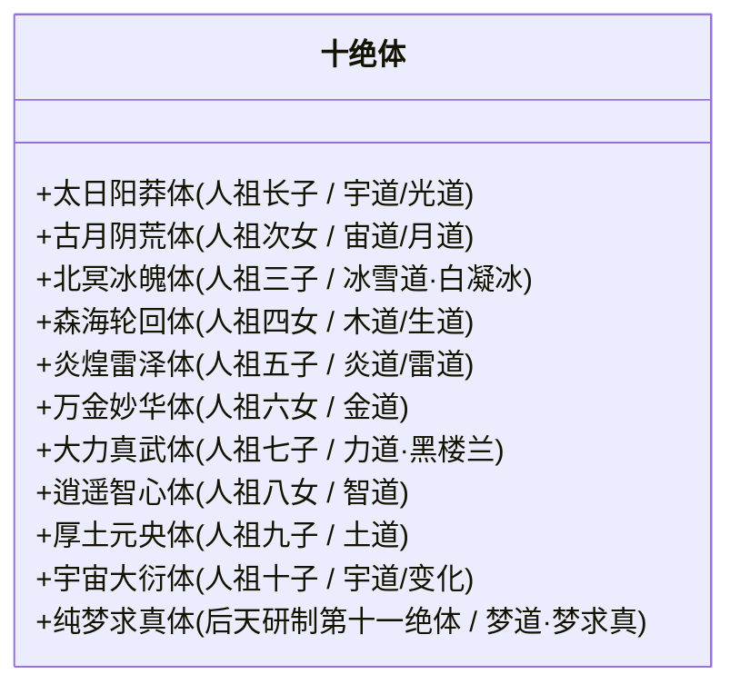
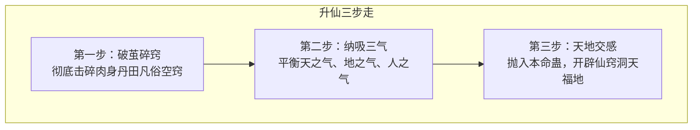

# 《蛊真人》修真体系与境界晋升指南

---

## 一、凡人蛊师境界（一转至五转）

蛊师的修炼基础在于腹部的**“空窍”**，通过空窍蓄积真元，温养和催动蛊虫。

### 1. 转数与真元颜色演化
凡人境界每转细分为四阶：**初阶、中阶、高阶、巅峰**。

| 境界等级 | 真元性质 | 质感与颜色 | 典型凡俗社会地位 |
| :--- | :--- | :--- | :--- |
| **一转** | 青铜真元 | 淡绿（初阶）$\rightarrow$ 翠绿（巅峰） | 族寨初出茅庐见习蛊师、斥候巡逻 |
| **二转** | 赤铁真元 | 淡红 $\rightarrow$ 深红 | 山寨中坚骨干、猎队队长、小商贾 |
| **三转** | 白银真元 | 淡银 $\rightarrow$ 纯白银华 | 家族家老、长老、寨子核心支柱 |
| **四转** | 黄金真元 | 浅金 $\rightarrow$ 灿金辉煌 | 一族之长、独霸一山的豪杰枭雄 |
| **五转** | 紫晶真元 | 浅紫 $\rightarrow$ 华贵深紫晶光 | 凡尘天花板、凡俗王侯、一域霸主 |

---

## 二、凡人资质与十绝体

### 1. 常规资质（开窍大典）
空窍内有元海，海面在整个空窍容积中所占的比例决定资质高低：
* **丁等资质**：20% ~ 39% 元海，资质低劣，终生难越二转，多为凡俗杂役。
* **丙等资质**：40% ~ 59% 元海，中下水平，侥幸可至二转中高阶。
* **乙等资质**：60% ~ 79% 元海，家族骨干苗子，有希望突破至三转家老。
* **甲等资质**：80% ~ 99% 元海，天赋异禀，真元恢复极速，家族族长与升仙种子。

### 2. 逆天体质：十绝体
十绝体是人祖十个子女血脉与天地至道极端结合的产物。其空窍元海充盈达到**整整十成（100%）乃至溢出**，元海时刻冲击空窍窍壁。

* **利弊共生**：
  * **超强神威**：修炼速度是凡人千百倍，真元近乎无穷无尽，催动杀招威能狂暴。
  * **夭折死咒**：因空窍无法承受持续膨胀的本源道痕，若不能在20岁左右登仙破境，窍壁必定彻底崩溃自爆，肉身魂魄化作飞灰（白凝冰即因北冥冰魄体险些暴亡自爆，后被方源借以炼制仙蛊）。
  * **升仙奇迹**：一旦十绝体成功度过登仙三气之劫，所开辟的仙窍福地底蕴超凡绝伦，远超寻常蛊仙百倍。

---

## 三、蛊仙之境（六转至八转）

凡人入仙，乃是生命本质的跃迁。一旦跨入六转，脱离肉体凡胎，称之为**蛊仙（Gu Immortal）**。

### 1. 登仙三气平衡
* **天之气**：来自浩渺高天的大道玄机。
* **地之气**：来自厚重大地的大道承载。
* **人之气**：蛊师毕生经历、阅历、心性、才情、魂魄累积的人道底蕴。
* *风险*：三气必须达到**绝对平衡**，稍有偏颇（天多化为道风散尽，地多化作石泥沉沦，人多自爆陨落）。

### 2. 蛊仙三境界详析

| 仙级境界 | 仙元储备 | 居所属性 | 灾劫体系 | 特征与地位 |
| :--- | :--- | :--- | :--- | :--- |
| **六转蛊仙** | 青提仙元 | **下等/中等/上等福地** | 经历**地灾**（每十年一次，共二十七次） | 仙界底层，长生开端，初步掌握仙道杀招，建立资源点。 |
| **七转蛊仙** | 红枣仙元 | **上等福地 / 特异福地** | 经历**天劫**（每五十年一次，共三次） | 仙界巨擘、中坚脊梁，各大超级势力长老与实权霸主。 |
| **八转蛊仙** | 白荔仙元 | **洞天（Aperture Grotto）** | 经历**大劫、浩劫、万劫**（浩劫万载一见） | 仙界天花板，威慑一域，尊者未出时代的绝对主宰。 |

---

## 四、蛊仙世界核心底层法则

### 1. 道痕互斥法则（The Conflict of Dao Marks）
* **原理**：天地间每个流派均有独特的道痕。寻常蛊仙的仙躯与仙窍长期浸润于单一流派，形成厚重的本派道痕。
* **后果**：
  * **攻防加成**：炎道蛊仙拥有十万炎道道痕，施展炎道杀招威力直接增幅十倍。
  * **排斥冲突**：若该炎道蛊仙催动水道杀招，不仅水道杀招会被自身十万炎道道痕剧烈削弱，甚至会引发体内道痕互噬自伤；同时外来的水道仙术打在身上，也会与自身炎道激烈爆炸。
  * **致命禁锢**：寻常蛊仙终其一生**只能专修一派**（极个别凭借特殊仙蛊兼修两派），多修必死。

### 2. 仙僵（Zombie Immortal）
* **成因**：蛊仙阳寿耗尽，或为苟延残喘避祸，主动或被动将肉身与仙窍逆转为活死人僵尸之躯。
* **代价**：
  * **死窍**：仙窍停止运转，化为一片死地废墟，大地腐败，天穹灰暗，不再自然产出仙元。
  * **思维迟钝**：脑海中念头极难自生，推演极为缓慢，需消耗大量智道念头蛊虫维持思考。
  * **好处与终局**：仙僵没有天劫地灾光顾；但道痕日渐剥落风化。原著方源在义天山大战前曾化为仙僵，后借九转至尊仙胎蛊破而后立。

### 3. 九转尊者之阶
* **超脱仙凡**：九转仙尊（正道）/ 九转魔尊（魔道）。
* **登顶九转的硬性门槛**：
  1. 仙窍度过三次**混沌大劫**；
  2. 自身主修流派境界达到**无上大宗师（Supreme Grandmaster）**（超越天道对该流派的理解）；
  3. 炼化天下五域两天的全部本流派自然道痕。
* **地位**：举世无敌，寿元有限但力压当世，一人之威凌驾天下众生与万千超级势力总和。

