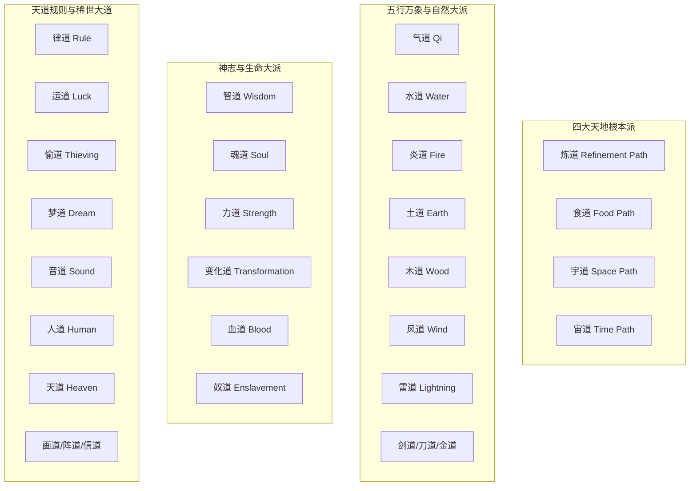

# 《蛊真人》全流派体系大统考

---

## 一、流派体系架构

在蛊界，“蛊是天地之秘，人是万物之灵”。流派是蛊师前仆后继参悟天地自然法则所开辟总结出的系统性道统。
蛊界流派百花齐放，相互生克演变。

---

## 二、核心主流大派深度剖析

### 1. 炼道（Refinement Path）
* **核心地位**：蛊界三大底层逻辑“养、用、炼”之首。一切蛊虫的诞生与晋级皆依赖炼道。
* **鼻祖与巅峰人物**：太古毛民传奇**长毛老祖**、当代**炼天魔尊方源**。
* **炼法流派**：
  * **人隔离派（毛民流派）**：利用天地自然之火、自然地脉与天道共鸣炼蛊，成功率极高，擅长大规模炼蛊，代表即长毛老祖与琅琊福地。
  * **毛发流派 / 精细人炼流派**：讲究神念操控微雕，对蛊仙意志、火候把握极尽苛刻。
* **终极绝景**：疯魔窟大战中，方源借天地熔炉与全五域炼道道痕炼化万物，以天下为铜炉，众生为药引。

### 2. 宙道（Time Path / 光阴岁月之流）
* **代表尊者**：**红莲魔尊**。
* **道韵特征**：掌控时间的流速（仙窍时间加速、减速）、定格、岁月回溯。
* **标志性造物**：宙河、春秋蝉、石莲岛、四时仙杀招。
* **战略价值**：仙窍内部时间流速决定了资源产出的周转速度与仙元产出，但也决定了天劫地灾来临的频次。

### 3. 宇道（Space Path / 虚空纳物之流）
* **代表尊者**：**盗天魔尊**。
* **道韵特征**：空间折叠、瞬移、咫尺天涯、仙窍扩张、虚空穿梭。
* **标志性仙蛊**：**定仙游**（心念所至、亲眼所见，天地万域皆可刹那传送）。

### 4. 智道（Wisdom Path / 算无遗策之流）
* **开派鼻祖**：**星宿仙尊**。
* **三大核心要素**：
  * **念（Thoughts）**：念头生灭，负责即时运算与思维爆发。
  * **意（Wills）**：意志凝结，具备独立判断与长期留存意志（如天意、方源意志、尊者遗意志）。
  * **情（Emotions）**：情绪波动，负责心境干扰、魅惑、士气与情绪杀招。
* **功能**：洞察天机、推演仙蛊方、推算推演仙道杀招、反制因果刺探、遮蔽自身天机命格。

### 5. 魂道（Soul Path / 寂灭屠戮之流）
* **开派始祖**：**幽魂魔尊**。
* **修持路径**：百人魂 $\rightarrow$ 万人魂 $\rightarrow$ 亿人魂 $\rightarrow$ 太古荒魂 $\rightarrow$ 纯净无瑕魂。
* **绝配秘境**：荡魂山壮魂 + 落魄谷炼魂。
* **代表应用**：分魂化身千万、搜魂夺忆、奴役神魂、至尊仙体神魂承载。

### 6. 变化道（Transformation Path / 万化归一之流）
* **开派始祖**：**狂蛮魔尊**。
* **流派核心**：**“一派拟万派”**。变化道蛊仙化身火鸟即具炎道道痕，化身玄武即掌水道土道。极尽灵活，肉搏与生存战力绝顶。

### 7. 运道（Luck Path / 命数气运之流）
* **开派始祖**：**巨阳仙尊**。
* **理论体系**：
  * **自身运**：决定个人机缘气数（狗屎运、鸿运齐天）。
  * **众生运**：众生因果气运相连（连运仙蛊）。
  * **天地运**：天地大势走向与风云际会。
* **名言**：“气运如水，变幻无常；借水行舟，天地同力。”

---

## 三、禁忌、绝世与特殊小众流派

| 流派名称 | 核心特征与杀伐手段 | 历史起源/代表人物 | 优缺点深度剖析 |
| :--- | :--- | :--- | :--- |
| **天道** | 损有余而补不足，执掌宿命与灾劫平衡 | 天地意志 / 晚年乐土 / 方源 | **绝顶至高**；但寻常蛊仙无法感悟，唯有至尊仙胎身或天道道痕方可掌握。 |
| **人道** | 万物之灵的人性光辉，人定胜天，以愿力破禁忌 | 《人祖传》 / 天庭大同风 / 方源 | 极具爆发力，无视常规道痕压制，对天道劫难有奇效，天庭的核心王牌。 |
| **梦道** | 大梦将起，入梦历练直接继承前世今生海量真意 | 预言中的大梦仙尊（凤金煌） | 无视流派壁垒暴增境界；但一旦沉沦梦境无法自拔便会魂飞魄散。 |
| **偷道** | 凭空盗取他人仙蛊、仙元、寿命、甚至道痕 | 盗天魔尊 | 匪夷所思的神偷手段；正面硬抗略有不足，多走机巧诡异。 |
| **血道** | 以活人鲜血为引，修炼速度极快，越级杀敌 | 血海老祖 | 极度嗜杀残暴，速成但易反噬，遭天下正魔两道共同严打围剿。 |
| **剑道** | 极度专注杀伤力，无坚不摧，一剑斩灭因果杀招 | 薄青（号称五域剑道第一仙） | 攻伐天下第一；但防御手段匮乏，天劫下极易陨落。 |
| **音道** | 音波振荡，九曲天籁，杀人于无形声律之间 | 凤九歌（九歌仙人） | 群攻、辅助、解禁全能，对神魂与肉身具备穿透式共振打击。 |
| **奴道** | 组建千万兽潮、异人大军，以一人敌一国 | 百兽王、常山阴（方源伪号） | 军团战无敌；但极其消耗神魂念头，自身肉身脆弱易被实施“斩首行动”。 |
| **画道** | 丹青画卷，画里藏仙，封存天地乾坤 | 元莲仙尊暗留 | 隐匿万载，天庭复生英灵的底牌，万法皆可入画封印。 |
| **食道** | 专门研究蛊虫粮饷饲喂与肉身肠胃消化道痕 | 远古大能传承 | 解决养蛊难题，能吞噬外物永久增强体内道痕。 |
| **阵道** | 布置仙阵，勾连天地地脉，以微小力量撬动天地伟力 | 池曲友（南疆池家太上大长老） | 阵成则坚不可摧；缺点是需要大量阵旗阵盘与漫长布置时间。 |

