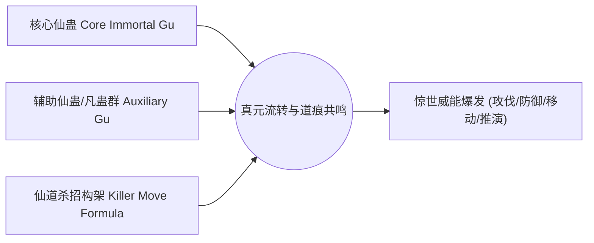
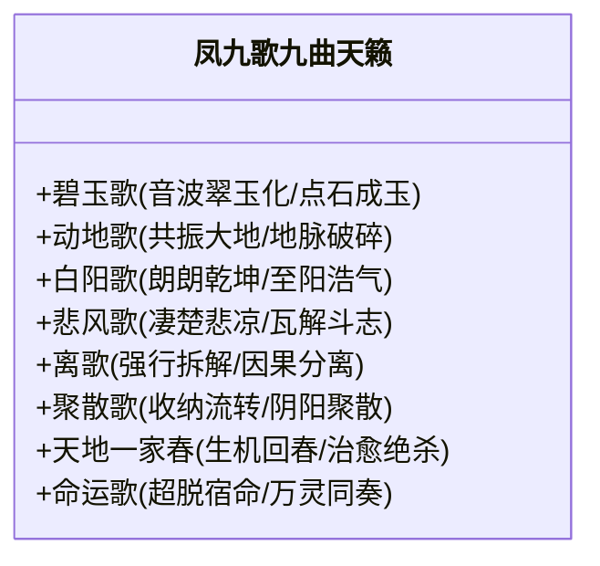

# 《蛊真人》经典仙道杀招合辑

---

## 一、仙道杀招机理与本质

在《蛊真人》体系中，单一蛊虫的能力是僵化、固定且单一的，极易被针对或破解。
**杀招（Killer Move）**，是将一只或数只核心仙蛊，搭配成百上千乃至数万只辅助凡蛊，借由特定的真元/仙元流转路线，共同激发的复合仙术。

---

## 二、主角古月方源标志性杀招

### 1. 逆流护身印（Reverse Flow Protection Seal）
* **流派构成**：律道 / 水道
* **核心基石**：天地秘境·**逆流河** + 牵丝蛊 + 坚持意志
* **杀招机制**：
  * 将逆流河化作一袭半透明的淡白流水长袍，披覆在方源体表。
  * **反弹万法**：任何袭向方源的仙道杀招、物理攻击或灵魂轰击，一旦接触流水长袍，皆会被逆流河判定为“逆流阻碍”，进而被**完完整整原路反弹**回施术者自身。
* **战史威名**：在逆流河一战与中洲追击战中，方源以七转之身硬扛八转蛊仙（雪胡老祖、中洲群仙、天庭宿老）的毁天灭地狂轰滥炸而毫发无损，威震五域。

### 2. 万我（Myriad Self）系列
* **流派构成**：奴道 + 力道（后续进阶为奴力变化万道归一）
* **研发背景**：方源为打破“奴力不可兼修”的千古魔咒，以自身力道虚影为基，融合奴道驭兽精粹所创。
* **演变谱系**：
  * **万我第一式·虚相狂潮**：刹那间挥洒出成千上万个力道虚影，每一个虚影皆具备方源真身一部分力量，铺天盖地。
  * **万我大手印**：无数力道虚影凝结为擎天巨手，抓摄山岳，捏爆仙阶荒兽。
  * **万我剑雨**：融合剑道仙蛊，万道虚影化为纯阳剑气暴雨。
  * **万我·大爱分身**：后期演化为独立的意志分身。

### 3. 引魂入梦（Lead Soul Into Dream）
* **流派构成**：魂道 + 梦道（超前时代降维打击）
* **核心仙蛊**：梦蝶仙蛊、魂道仙蛊
* **杀招机制**：
  * 跳过目标的一切常规肉身与道痕防御，直接将敌对蛊仙的神魂硬生生拽入无边梦境之中。
  * **无解控制**：在梦道尚未大普及的时代，寻常八转蛊仙乃至太古荒兽一旦中招，便瞬间陷入深度昏迷做梦状态，任人宰割。方源以此招连斩多位八转强敌。

### 4. 鬼官遮天 / 阎罗殿（Ghostly Concealment / Emperor Yama）
* **流派构成**：魂道 + 偷道 + 智道
* **杀招机制**：
  * 盗天魔尊“神不知、鬼不觉”两大极品天外杀招与幽魂秘法结合。
  * **屏蔽天机**：使天地意志（天意）与一切智道推演宗师彻底“失明”，无法感知算计方源的因果踪迹与命格走向。

---

## 三、宿命战神——凤九歌惊世九歌

凤九歌，音道万古第一奇才，“龙凤和鸣”之尊，其仙道杀招以**“九曲天籁”**独步天下：

* **离歌（Separation Song）**：专门分离、瓦解一切仙阵、仙蛊屋与他人杀招构架，能让敌人的杀招在轰击中途自行四分五裂。
* **命运歌（Destiny Song）**：凤九歌领悟宿命与自由之奥义所创巅峰绝响。不受宿命蛊束缚，能根据敌我强弱逆转命数，助强扶弱亦能逆天改命，被天庭与诸尊皆叹为惊世天籁。

---

## 四、名宿大能标志性杀招

### 1. 武庸（南疆武家之主）
* **风声鹤唳（Wind Sounds and Crane's Cry）**：狂风呼啸化为凄厉鹤鸣，音波与风刃渗透仙窍，心生恐惧者五脏俱裂。
* **清风剪（Clear Wind Scissor）**：无形无质的风道极速剪刀，锋利至极，可瞬息腰斩同阶八转蛊仙。
* **玉清滴风小竹楼（仙蛊屋合击）**：攻防一体，遁速冠绝南疆。

### 2. 龙公（天庭领袖，红莲之师）
* **气擎天（Qi Holding Heaven）**：原始仙尊嫡系传承，双掌托天，凝聚万丈纯阳气柱，一掌可崩碎太古荒兽。
* **九转归虚（Nine Dragons Return to Void）**：逆转生机，燃烧残躯爆发生命潜能，化为九条遮天金龙碾压全场。
* **龙人化生**：将凡人同化为长寿坚韧的龙人一族，人道与变化道奇诡结合。

### 3. 薄青（剑道五域第一人 / 幽魂分魂）
* **五域剑斩**：剑出如长虹贯日，剑光横贯中洲万里长空，“五域同震，一剑霜寒十四州”，无坚不摧。

