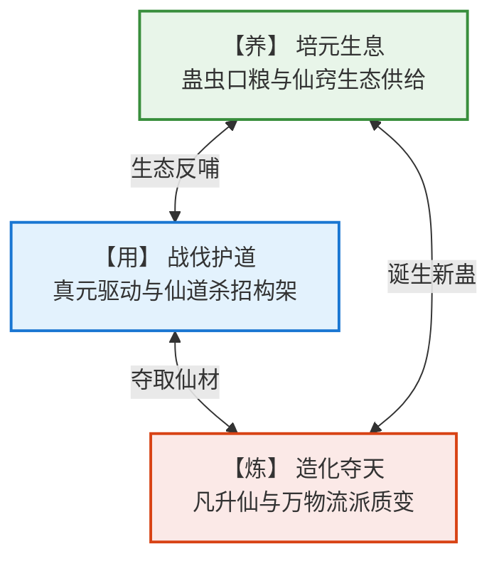
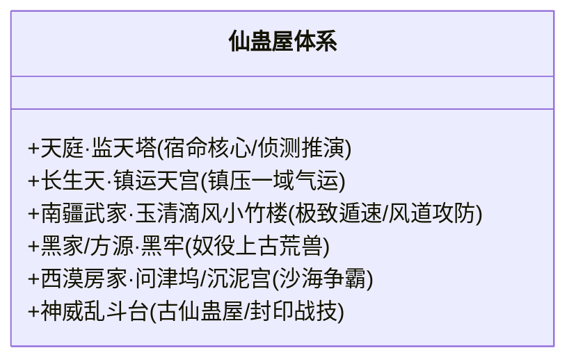

# 《蛊真人》养、用、炼大道法则

---

## 一、“养、用、炼”三大基石哲学

> **“养蛊、用蛊、炼蛊，乃天下蛊师安身立命之本。三者相辅相成，缺一不可。”**

---

## 二、【养】—— 蛊虫口粮与仙窍经济危机

### 1. 凡蛊之养
凡蛊口粮相对平易，多取自凡俗自然植物、矿石或兽肉：
* 例：**月光蛊**吸食月兰花瓣；**小光蛊**吸食白花瓣；**酒虫**需以陈年美酒浸泡喂养；**自力更生蛊**需食用生猪肉。

### 2. 仙蛊之养：吞金无底洞
一旦升华至仙蛊，其食量之苛刻、所耗仙材之昂贵令人发指。**“养得起仙蛊，才算真正蛊仙”**：
* **春秋蝉**：饮用宙河之水（若在外界需定期前往宙河支流采水，否则会干枯而亡）。
* **定仙游**：需定期进食太古六转木道灵竹——碧玉天竹的嫩芽。
* **智慧蛊**：散发智慧之光需汲取漫长寿元或高级智道生机仙材。
* **至尊仙胎蛊**：每隔一段时间**必须吞噬一座包含特定流派道痕的十绝体仙窍福地**，否则仙躯将自内向外萎缩崩溃。
* **蛊仙之窘境**：许多散修六转、七转蛊仙，虽然侥幸获得一只仙蛊，却往往被仙蛊那严苛的口粮拖垮了整个仙窍经济，甚至不得不将仙蛊抵押或低价贱卖。

---

## 三、【用】—— 真元催动与仙蛊屋合击

### 1. 战力倍增法则
* **单蛊难成气候**：一只仙蛊能力再强，手段也是单调死板的。例如单纯催动“力道仙蛊”，敌人只需施展一道柔水绕劲或幻象，就能让巨力落空。
* **仙道杀招的化合反应**：以一只仙蛊为帅，数只辅助仙蛊为将，万千凡蛊为兵，形成逻辑闭环。不仅能弥补短板（增加锁敌、防御反噬、隐匿气息），更能将单一威能拔升数倍至数十倍。

### 2. 蛊师战争工业巅峰：仙蛊屋（Immortal Gu House）
仙蛊屋是多名蛊仙将数只甚至数十只仙蛊、数百万只凡蛊，以阵法形式永久性固化拼装而成的**仙道移动战争堡垒**。

* **仙蛊屋三大神效**：
  1. **凡仙皆可御**：操纵者不一定需要具备对应的极高流派境界，只要填入足够的仙元即可爆发稳定威能。
  2. **庇护乘员**：极难被正面攻破，内部蛊仙受仙蛊屋厚重防御庇护，免受流派道痕反噬。
  3. **集体合力**：可集中多位蛊仙的仙元，实现凡人与低阶蛊仙联手抗衡甚至围杀八转大能的逆天战绩。

---

## 四、【炼】—— 逆天造化与道痕契约

### 1. 炼蛊之险：九死一生
* **失败反噬**：炼制凡蛊失败，蛊师尚且只是气血逆流、吐血受伤；然而炼制**六转以上仙蛊**，失败率高达99%以上。
* **代价惨重**：升炼仙蛊一旦失败，耗费百年积累的海量八转仙材将瞬间化作飞灰，操纵炼阵的蛊仙更会遭受强烈的道痕反噬，轻则神魂重创、仙窍残破，重则肉身崩溃当场身死道消。

### 2. 两大炼道流派对立

| 炼道派系 | 核心原理 | 代表势力与人物 | 优劣势剖析 |
| :--- | :--- | :--- | :--- |
| **隔离流派 / 毛民自然派** | 借天地自然伟力（地火、天雷、海潮、地脉）进行熔炼，人与蛊材隔离，顺应天道。 | 太古毛民、琅琊福地、长毛老祖 | **成功率显著偏高**，适合炼制绝品仙蛊；但需要极高的地利天时与漫长炼制周期。 |
| **精细流派 / 人族微操派** | 依靠蛊仙自身庞大神念、智道推演与极致入微的真火控制，强行逆转道痕。 | 中洲十大古派、天庭诸仙 | **机动灵活**，受环境限制小；但对蛊仙心力要求变态，极易因瞬间失误导致满盘皆输。 |

### 3. 血祭与偷天换日
魔道蛊仙为了强行提升炼蛊成功率，常开辟偏门：
* **血祭万灵**：如方源早期在青茅山屠杀古月全族凡人炼制血颅蛊，以血亲血脉激发资质跃迁。
* **夺天机炼法**：在天地秘境（如炼海、疯魔窟）中借助天地原生道痕，行偷天之举。

