# 《蛊真人》经典与绝世仙蛊录

---

## 一、蛊之真谛与位阶法则

> **“蛊是天地之精，人是万物之灵。千般变化，万种玄机，皆在养、用、炼三字之中。”**

蛊虫分为**一转至五转凡蛊**与**六转至九转仙蛊**（理论上存在十转）。
* **仙蛊唯一法则**：在天地五域九天之中，**同一种仙蛊在同一时间内只能存在一只**。仙蛊若未毁灭，天下无人能炼出第二只同名仙蛊。
* **道痕凝聚**：仙蛊本质上是天地某种大道道痕高度凝缩的生命体碎片。

```mermaid
graph TD
    classDef top fill:#fff9c4,stroke:#fbc02d,stroke-width:2px;
    classDef high fill:#e1bee7,stroke:#8e24aa,stroke-width:2px;
    classDef legend fill:#bbdefb,stroke:#1976d2,stroke-width:2px;

    Fate["九转·宿命蛊 (Fate Gu)<br/>天道主宰 / 苍生枷锁"]:::top
    Fetus["九转·至尊仙胎蛊 (Sovereign Immortal Fetus)<br/>无冲突体质 / 万道归一"]:::top
    Wisdom["九转·智慧蛊 (Wisdom Gu)<br/>智慧光晕 / 极速推演"]:::top

    Spring["六转/七转·春秋蝉 (Spring Autumn Cicada)<br/>逆流光阴 / 重生溯源"]:::high
    Fixed["六转·定仙游 (Fixed Immortal Travel)<br/>念动身至 / 跨越五域"]:::legend
    Attitude["八转·态度蛊 (Attitude Gu)<br/>人道假面 / 欺天瞒地"]:::high
    Love["九转·爱蛊 (Love Gu)<br/>情不知所起 / 天下至强亦至烈"]:::top
    Perseverance["坚持蛊 (Perseverance Gu)<br/>人祖传之骨 / 万折不挠"]:::legend
```

---

## 二、绝世逆天神蛊详述

### 1. 春秋蝉（Spring Autumn Cicada）
* **流派**：宙道
* **位阶**：六转（后可升七转）
* **开创者**：红莲魔尊
* **神异能力**：
  * **溯流光阴，重回过去**：自爆蛊仙肉身与修为，将蛊仙所有的神念、记忆与神魂压缩注入春秋蝉内，逆着宙河逆流而上，跳入过去某个时间节点的自己空窍中，实现**“重生”**。
* **代价与弱点**：
  * 催动成功率并非100%（受使用者气运、宙河风浪影响，稍有不慎便在宙河浪花中神形俱灭）。
  * 寄居于空窍时，会持续削弱宿主空窍生机与气运（极度带来厄运）。

### 2. 至尊仙胎蛊（Sovereign Immortal Fetus Gu）
* **流派**：全流派 / 天道 / 人道
* **位阶**：九转（蛊界造化神迹）
* **炼制者**：幽魂魔尊（影宗布局十万载，牺牲十绝仙僵） $\rightarrow$ **古月方源夺舍继承**
* **逆天特异性**：
  * **无冲突体质（Non-conflicting Dao Marks）**：打破蛊界“道痕互斥”的万古天规。身躯可容纳全天下所有流派道痕，修炼炎道同时修炼水道、魂道、剑道，威力不仅不互斥，反而彼此叠加成倍暴增！
  * **至尊仙窍（Sovereign Immortal Aperture）**：窍内面积浩瀚堪比一域，包含小五域与小九天，时间流速飞快，仙元积累与资源孕育效率极高。
  * **吞窍消灾**：只需吞并同派别的外界福地洞天，即可直接免除自身的天劫地灾，并继承其全部道痕。
* **唯一弱点**：仙胎肉身需要定期进食“十绝体仙窍”作为食粮，否则身体会逐步衰竭崩解。

### 3. 宿命蛊（Fate Gu）
* **流派**：天道
* **位阶**：九转
* **镇守之地**：中洲天庭·监天塔顶端
* **至高法则**：
  * **“天意注定，无可违逆”**：天下众生的出生、荣辱、相遇、死亡、成败，皆被宿命蛊一笔勾销或定格。红莲不能救师，幽魂不能永生，巨阳不能挽留寿元，皆因宿命有常。
  * **唯二克星**：**天外之魔（Otherworldly Demon）**（来自异世界，不属天道掌控，如方源）、**爱蛊**（《人祖传》记载“宿命被爱情所伤”）。

### 4. 智慧蛊（Wisdom Gu）
* **流派**：智道
* **位阶**：九转
* **神异与机制**：
  * 散发幽蓝色的**“智慧光晕”**。
  * 任何蛊师沐浴在智慧光晕中，脑海中的灵感与念头将呈千万倍光速碰撞，弹指之间推演出失传数万年的残缺仙蛊方、无上杀招架构或战局死局。
  * **致命副作用**：普通活人蛊仙沐浴智慧之光，寿命会以肉眼可见的速度飞速蒸发扣除。方源在仙僵时期因“肉身已死，寿命为零，无可扣除”，得以毫无顾忌地狂蹭智慧之光，奠定雄厚底蕴。

### 5. 定仙游（Fixed Immortal Travel）
* **流派**：宇道
* **位阶**：六转
* **能力**：
  * 只要催动者心中有清晰的具体景象记忆（甚至哪怕只是曾亲眼见过一眼的光景），真元一动，便可在弹指间跨越千里万里、无视五域界壁，直接传送到该地。
  * 乃是行军突袭、夺宝跑路的绝顶战略神蛊。

### 6. 态度蛊（Attitude Gu）
* **流派**：人道 / 智道
* **位阶**：八转
* **典故**：源自《人祖传》人祖戴上态度的面具欺骗世人。
* **能力**：
  * 消耗意念催动，不仅能毫无破绽地伪装面目表情，更能完美伪装蛊仙的真元气息、气血道痕，乃至灵魂波动，连八转智道大能近距离探查亦无法看穿。

### 7. 爱蛊（Love Gu）
* **流派**：人道
* **位阶**：九转
* **典故与威能**：
  * 唯一一只能够伤害甚至撕碎宿命蛊一角的人道奇蛊。
  * **任性至极**：爱蛊无法被常理炼化奴役，它只凭“自愿”寄宿于心怀挚爱之人的心中（如赵怜云）。催动时不消耗仙元，但会随机抽取宿主的容貌、寿命、器官或亲情作为惨烈代价。

---

## 三、核心仙蛊品鉴一览表

| 仙蛊名称 | 位阶 | 核心流派 | 奇效与作用 | 标志性持有者 |
| :--- | :--- | :--- | :--- | :--- |
| **春秋蝉** | 六/七转 | 宙道 | 溯流光阴，神魂重生逆天改命 | 红莲魔尊、古月方源 |
| **至尊仙胎蛊** | 九转 | 全流派/天道 | 消除道痕互斥，开辟至尊仙窍 | 幽魂魔尊（炼制）、古月方源 |
| **宿命蛊** | 九转 | 天道 | 设定天地一切宿命轨线 | 天庭（元始～星宿～龙公） |
| **智慧蛊** | 九转 | 智道 | 智慧光晕爆发无限推演灵感 | 历代智仙、古月方源 |
| **定仙游** | 六转 | 宇道 | 目之所及，瞬息万里空间跳跃 | 方源、天庭、凤九歌 |
| **态度蛊** | 八转 | 人道/智道 | 极致伪装气息神魂，欺天瞒地 | 盗天魔尊遗留、方源 |
| **变异蛊** | 六转 | 变化道 | 模拟万物形态与道痕结构 | 狂蛮魔尊、方源 |
| **气运蛊/连运** | 六转 | 运道 | 将彼此气运相连，祸福与共 | 巨阳仙尊、方源 |
| **狗屎运蛊** | 六转 | 运道 | 虽名粗鄙，却能提供极强狗屎好运 | 巨阳仙尊真传、方源 |
| **寿蛊** | 凡/仙阶 | 天道自然 | 服用直接增长阳寿百年至数百年，无法人工炼制 | 历代尊者与天下蛊仙争抢 |
| **坚持蛊** | 传奇 | 律道/人道 | 逆流河破浪之基，赋予无坚不摧的道心 | 方源 |

