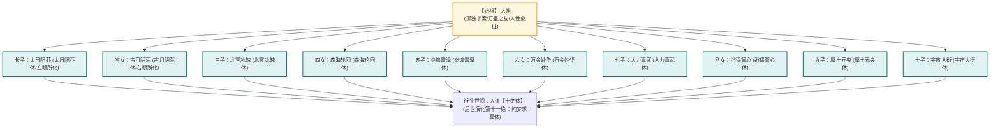

# 《人祖传》全释：神话隐喻与大道哲学

---

## 一、《人祖传》在《蛊真人》中的崇高地位

《人祖传》是贯穿整部《蛊真人》两千余章的**精神图腾、大道源流与哲学总纲**。
作者借人祖及其十个子女在天地蛮荒时代的漂泊、抗争、沉沦与觉醒，以极其惊艳的东方寓言形式，将人性的弱点、世态的炎凉、大道的规则与蛊虫的由来诠释得淋漓尽致。

> **“天地是一座大熔炉，人祖是炉中第一撮飞灰。每一只传世的仙蛊，皆曾在人祖的血泪中啼哭过。”**

---

## 二、经典核心寓言深度精析

### 1. 规矩与希望篇：人族的黎明
* **典故**：
  * 太古初开，人祖孤身一人在苍茫荒野行走，四周黑夜无边，被【困难】与【绝望】化作的猛兽围攻，瑟瑟发抖。
  * 遇到**【规】蛊**与**【矩】蛊**。两蛊教导人祖：“不以规矩，不能成方圆”。人祖依规矩行事，方能安身立命。
  * 当人祖被【绝望】深渊吞噬、万念俱灰时，一只微弱如萤火的小蛊飞入人祖胸膛——正是**【希望蛊】**。
  * 希望蛊轻声道：“人啊，别怕。只要你的心中还有一星半点对明天的渴求，我就永远不会熄灭。我虽微弱，却能指引你走出绝望的黑夜！”
* **哲学喻意**：凡人修炼的第一步“开窍”，正是将希望蛊捏碎在丹田。人生于世，纵使身陷绝境万劫不复，唯有希望是最后不灭的光亮。

### 2. 力量与智慧篇：人祖的代价
* **典故**：
  * 人祖想要降服荒兽，向**【力量蛊】**寻求帮助。力量蛊冷漠地说：“我可以赐予你撕碎万物的神力，但你要把你的青春和健美的肉体作为饲料给我享用。”
  * 人祖为了自保，答应了力量蛊，因此容颜衰老，身躯佝偻。
  * 随后人祖面对险恶阴谋，向**【智慧蛊】**求教。智慧蛊诡黠地说：“我可以赐予你洞察万物的机智，但你要拿你宝贵的寿命和内心的安宁来喂养我。”
  * 人祖再次妥协。
* **哲学喻意**：世间一切看似唾手可得的超凡威能，暗中早已标好了残酷的价码。追求力量失去青春，追逐机巧算计损耗寿命心神。

### 3. 态度与面具篇：人心的伪装
* **典故**：
  * 人祖在红尘中行走，常因直白吐露心声而遭野兽嫉恨与同伴出卖。
  * 智者送给人祖一只**【态度蛊】**，那是一张薄如蝉翼的面具。
  * 人祖戴上面具，面对愤怒时露出温和笑脸，面对仇敌时展现恭敬谦卑。猛兽被骗过，世人纷纷赞美他成熟得体。
  * 很久以后，人祖回到家中想要摘下面具，却惊骇地发现，**面具已与他的皮肉骨血彻底长在了一起**，无论怎么撕扯都会连皮带肉鲜血淋漓，他再也找不回原本真实的自己。
* **哲学喻意**：成年人在世俗社会中的逢迎与伪装，初时只为自保生存；时日一久，伪装反噬心智，世人往往沦为自己最厌弃的假面奴隶。

### 4. 逆流河与坚持篇：生死的鸿沟
* **典故**：
  * 人祖的长子太日阳莽陨落，魂魄堕入生死门。
  * 人祖为了复活长子，历尽千难万险杀入生死门，死神告诉他：“想要带走亡魂，唯有徒步逆着逆流河走出去。在逆流河中，不可使用任何蛊虫，不可止步，不可回头。”
  * 人祖背着太日阳莽，在急流汹涌的逆流河中逆水而上。冰冷的河水如刀割裂皮肉，每前进一步都要耗尽浑身骨血。
  * 当走到逆流河仅剩最后三步、对岸的光明已触手可及之时，人祖心生一丝懈怠，轻叹了一口气，脚步停滞了一瞬。
  * 刹那间，狂暴的逆流滔天而起，将人祖无情卷落回深渊，太日阳莽重归死境。
* **哲学喻意**：**“行百里者半九十”**。世间万事，功败垂成往往就在触手可及的最后关头。若无**【坚持蛊】**铭刻神魂深处，凡人的意志终会在终点线前崩塌。方源日后正是凭借此寓言与无悔道心，在万仙瞩目下肉身趟穿逆流河！

### 5. 爱情与宿命篇：天道的裂痕
* **典故**：
  * 天地间最不可一世、代表绝对铁律的九转神物，乃是**【宿命蛊】**。宿命定下生死寿夭，众生皆为提线木偶。
  * 人祖之子太日阳莽在绝望与苦海中，遇到了一只名为**【爱】**的蛊。
  * 太日阳莽为了心中的爱意，不惜粉身碎骨化为飞灰，将毕生赤诚献祭。
  * 在炽烈无匹的情感洪流冲刷下，不可一世、坚不可摧的宿命蛊，竟被【爱】生生啄下了一角碎片！
* **哲学喻意**：唯有至情至性、不计得失利害的炽烈大爱，方能在冷酷冰冷的天道宿命法则上凿出一道反叛的曙光。

### 6. 自我篇：天地唯一的真谛
* **典故**：
  * 人祖沉沦在名利场与万象迷宫中，丢掉了最重要的东西。
  * 他寻找自己的手，手在贪婪索取；寻找自己的眼睛，眼睛在凝视虚妄；寻找自己的心，心在恐惧跳动。
  * 人祖茫然四顾，低头狠狠咬了自己一口。鲜血涌出，剧痛钻心。
  * 在痛彻心扉的惨烈中，一只通体无瑕、剔透纯净的蛊虫从伤口中飞了出来——那是天下最难觅寻的**【自我蛊】**！
* **哲学喻意**：不被世俗赞誉所迷，不为外界毁谤所动。痛过、苦过、撕裂过，方能认清并执掌真正的“自我”。这也是方源一生行事从不懊悔、孤高独立于世间的最深邃注脚。

