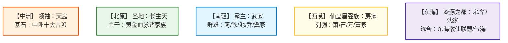
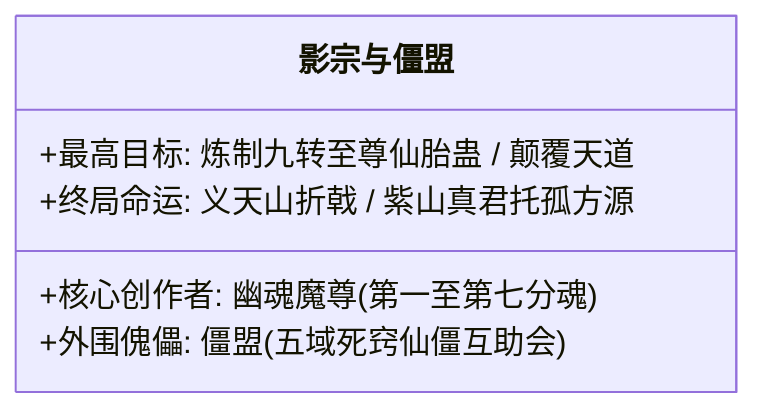

# 《蛊真人》五域各大超级势力志

---

## 一、五域势力格局总览

蛊界五域政治组织形式各异：中洲奉行**宗门制**；北原依仗**黄金血脉部落制**；南疆依托**险山家族寨子制**；西漠依托**绿洲家族集权制**；东海则是**海岛世家与散修共治**。

---

## 二、各大超级势力深度全览

### 1. 中洲：天庭（Heavenly Court）与十大古派
* **历史底蕴**：原始仙尊于太古时代创立，传承超**三百万年**。人族第一大圣地，统治中洲乃至号令五域三百万年之久。
* **组织体制**：
  * **门派公天下制**：天庭不以血脉承袭，而是从下属“中洲十大古派”中挑选最卓越忠诚的八转精英蛊仙飞升入天庭。
  * **仙墓机制**：寿元将尽的天庭蛊仙，可将自身封印于天庭中央仙墓中沉睡休眠，待天地大劫或天庭危难时苏醒，爆发出恐怖的远古战力。
* **中洲十大古派**：
  1. **灵缘斋**（出过白晴仙子、凤金煌，招募凤九歌）
  2. **天莲派**（元莲仙尊亲创嫡系）
  3. **仙鹤门**（方源凡人时期接触，方正加入的宗门）
  4. **灵蝶谷**、**古魂门**、**万龙坞**、**风云府**、**战仙宗**、**天妒楼**、**黑天寺**。

### 2. 北原：长生天（Longevity Heaven）与黄金家族
* **无上圣地**：**长生天**，乃中古时代巨阳仙尊创立的九转大洞天。长生天坐落于太古白天深处，镇运天宫镇压北原万世气运。
* **黄金血统体制**：
  * 唯有体内流淌巨阳仙尊血脉的后裔，方可被称为**“黄金家族”**（Hei 黑家、Liu 刘家、Ye Lui 耶律家、Ma 马家、Dongfang 东方家、Nuo'er 努尔家等）。
  * 黄金家族享有垄断北原资源的特权；非黄金家族部落只能被奴役或在十年暴风雪中充当炮灰。
* **王庭争霸赛**：每隔十年北原大雪灾降临前，各大部族在草原展开血腥大洗牌，唯有最终胜者方能进驻巨阳仙尊设立的**王庭福地**避难并继承真阳楼机缘。

### 3. 南疆：武家为首的崇山家族群
* **霸主武家**：
  * 历任家主性格强势霸烈，以战功开疆拓土。武独秀陨落后，武庸掌舵，力压南疆群雄，组建**南疆正道联盟**。
* **各大世家特色**：
  * **商家（商量山）**：南疆最大商贸中心，规矩森严，凡人与蛊仙皆可自由买卖，商燕飞治下盛极一时。
  * **铁家**：以捕盗除魔闻名天下，性格冷峻严苛如铁，标志性建筑为移动监牢【铁血楼】。
  * **池家**：阵道世家，南疆一切超级仙阵皆有池家手笔，依靠阵道技术在各大势力间长袖善舞。

### 4. 西漠：沙海战车房家
* **西漠环境**：沙漠绿洲遍布，地底富含黑油地脉。
* **房家绝技**：
  * 西漠最精擅打造与运用**仙蛊屋**的超级世家。
  * 拥有“问津坞”、“沉泥宫”、“落英馆”等多座顶级仙蛊屋，甚至能以仙蛊屋大阵围猎强敌。后在大爱仙尊方源的暗中支持与挑拨下，掀起西漠正道全面内战。

### 5. 东海：富庶海阀与异人复苏
* **地理优势**：五域物产最为丰盛之地，少有连绵战火，各大世家（宋家、华家、沈家）富得流油，蛊仙性格相对守成温吞。
* **气海老祖与异人崛起**：
  * 后期方源以分身“气海老祖”横空出世，以无上气道战力整合东海散仙。
  * 东海深海中潜藏着鲛人王庭、毛民、石人等异人族群，在方源暗度陈仓下组建五域最大的**异人联合势力**。

---

## 三、地下霸主与隐秘暗黑势力

* **影宗（Shadow Sect）**：
  * 幽魂魔尊死后七大分魂所组建的终极谍报暗杀组织，暗中渗透五域各大超级势力达十万年之久。
  * 其组织纪律极为森严，为了达成炼制九转至尊仙胎蛊的目标，不惜献祭代代分魂的全部性命。
* **僵盟（Zombie Alliance）**：
  * 表面上是五域寿元耗尽、沦为仙僵的流亡蛊仙互助联盟，实则是影宗为搜集天下十绝体与仙僵材料设立的掩护外壳。

