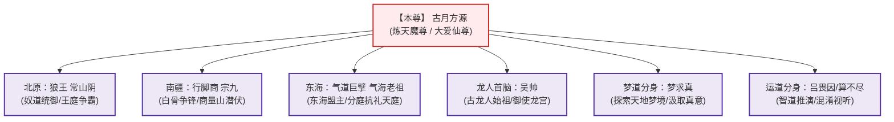
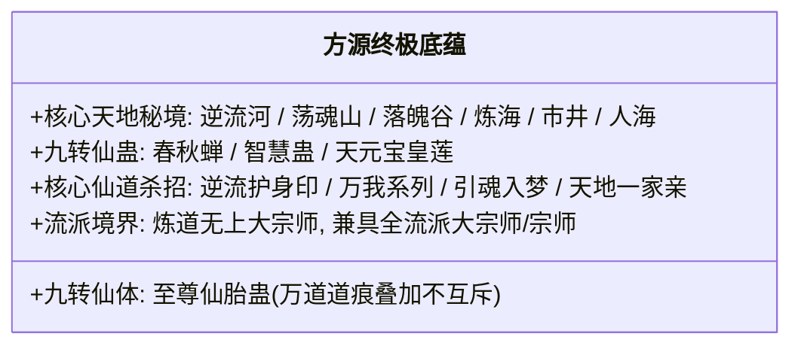

# 主角古月方源全档案与马甲志

---

## 一、人物基本档案

* **姓名**：古月方源（Fang Yuan）
* **尊号**：**炼天魔尊**（五域正道公认尊号） / **大爱仙尊**（方源自封并昭告天下尊号）
* **本质身份**：天外之魔（来自地球的穿越者）、五百年魔道老怪重生者
* **道心与终极执念**：**【永生】**
* **人生信条**：
  > “早岁已知世事艰，仍许飞鸿荡云间。一路寒霜明月照，拔剑斩落九重天！”
  > “永生或许并不存在，但只要在追求永生的路上倒下，纵然粉身碎骨、万劫不复，我亦从不后悔。”
  > “天地不仁，以万物为刍狗；我视世人为刍狗，亦视自己为刍狗。”

---

## 二、道心境界与性格特质

1. **绝对纯粹的理性与求道者**：
   * 方源不是为了作恶而作恶的低级魔头，也不是追求声色犬马的俗物。
   * 道德、规矩、正邪、亲情、权势于他而言，皆是实现终极目标的“工具”与“外物”。
   * 需要行善博取利益时，他比大善人更慈悲温厚；需要冷酷杀戮时，他比地狱恶鬼更狠辣决绝。
2. **坦荡从容，绝不内耗自欺**：
   * 面对逆境、绝境甚至濒死，方源从未怨天尤人，亦无一丝懊悔。
   * “成王败寇，技不如人便死，如此而已。”这种超然豁达让敌对的尊者（星宿、巨阳）亦心生敬畏。
3. **演技通神，脸皮比界壁还厚**：
   * 疯魔窟大战成尊后，明知五域群仙皆知其魔头本性，仍堂而皇之自封“大爱仙尊”，在宝黄天公开接单帮全天下蛊仙“炼制仙蛊”，实则借此大肆收割全天下仙材、要挟各方超级家族。

---

## 三、经典马甲与分身全录

### 1. 【常山阴】—— 北原孤傲狼王
* **潜伏时期**：第三卷《蛊仙啸傲出凡尘》
* **手段与做派**：伪装成北原失踪多年的传奇奴道大师“常山阴”。面容冷峻、骑乘白眼狼王、统领数十万狼群横扫北原王庭争霸赛。
* **功绩**：成功助黑楼兰夺得王庭福地名额，潜入八十八角真阳楼核心，一手引爆真阳楼倾覆，震撼北原数万年格局。

### 2. 【气海老祖】—— 绝世隐修气道泰斗
* **潜伏时期**：第五卷末至第六卷初
* **手段与做派**：以太古气道绝顶大能之姿现世，坐拥东海气海，举手投足掀起亿万气道波涛。
* **功绩**：与天庭龙公正面交锋平分秋色；被东海各大超级世家尊奉为“东海正道联盟盟主”，暗中却将东海资源源源不断输送给方源本尊。

### 3. 【吴帅】—— 龙人复兴始祖
* **潜伏时期**：掌控八转仙蛊屋【龙宫】
* **手段与做派**：以中古时代被天庭灭绝的龙人天才吴帅身份复苏，手握梦道大阵，统合两天异人族群（毛民、雪民、石人、墨人），掀起反攻天庭的浩瀚狂澜。

### 4. 【梦求真】—— 梦道先锋
* **特质**：专修梦道的分身，其肉身为后天人工研制的第十一绝体——**【纯梦求真体】**。不受梦境侵蚀同化，穿梭于历代尊者与大能的梦境遗迹之中，为方源本体疯狂汲取全流派无上境界真意。

---

## 四、核心战力与身家底蕴

* **至尊仙窍现状**：
  * 内涵小五域（小中洲、小北原、小南疆、小西漠、小东海）与小九天。
  * 容纳数千种荒兽、上古荒兽、太古荒兽，数以亿计的异人信徒（毛民、石人、雪人），全天候批量产出胆识蛊、仙材与仙元。

