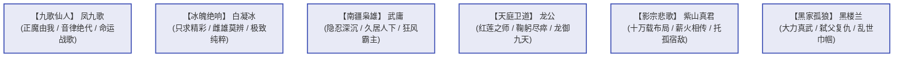

# 《蛊真人》风流人物谱与群雄志

---

## 一、风云人物性格与战史

《蛊真人》之所以被无数读者奉为神作，不仅在于主角方源的极致求道，更在于书中塑造了一群**有血有肉、智商在线、绝无脸谱化的各路枭雄与天骄**。

---

## 二、绝代豪杰深度评传

### 1. 凤九歌（Feng Jiu Ge）—— “世间唯我，正魔由心”
* **身份**：中洲灵缘斋护法、凤金煌之父、天下第一八转音道仙人。
* **生平与风骨**：
  * 早年以魔道身份纵横天下，后被灵缘斋仙子白晴感化招安，加入中洲正道。
  * 他行事光明磊落，傲岸不群。宿命大战期间，面对宿命蛊对众生生死的冷酷裁决，他在天庭最需要他维护宿命的关键时刻，毅然顿悟并唱响《命运歌》，助方源击碎宿命枷锁！
* **经典语录**：
  > “我本是魔，亦可是正。正魔由我，不由天！”
  > “此去若是一去不回，便一去不回！”

### 2. 白凝冰（Bai Ning Bing）—— “若生不精彩，毋宁死”
* **体质与流派**：北冥冰魄体（十绝体）、冰雪道
* **性格特征**：
  * 不在乎生死，不留恋权力，不贪恋财富，毕生唯一的执念是**“人生的极致精彩”**。
  * 被方源用阴阳转生蛊逆转为女儿身后，与方源展开长达数百章的生死智斗与博弈。
  * 既是方源最危险的宿敌，又是最默契的合作者。
* **名场面**：青茅山自爆冰封群山；义天山复生反水背刺方源；白发蓝眸独立于冰雪之上，笑傲苍天。

### 3. 武庸（Wu Yong）—— “我武庸岂是郁郁久居人下之辈！”
* **身份**：南疆武家太上大长老、南疆正道联盟盟主、风道八转绝顶大能。
* **枭雄风范**：
  * 在母亲武独秀（南疆第一铁娘子）活着时，武庸伪装成平庸孝顺的守成之犬，隐忍数百年不露锋芒。
  * 母亲陨落后，南疆诸强围攻武家，武庸瞬间撕下伪装，施展八转杀招“清风剪”与“风声鹤唳”，雷霆万钧连斩多位八转蛊仙，尽显无上政治手腕与刚烈霸气。
* **名言**：
  > “我武庸岂是郁郁久居人下之辈！”

### 4. 龙公（Duke Long）—— 天庭最后的脊梁
* **身份**：原始仙尊之后天庭掌舵人、红莲魔尊之师、龙人一族创造者。
* **宿命悲剧**：
  * 曾创立龙人一族以延寿，却被宿命蛊警示“龙人当立，人族将衰”，为了人族正统与天庭大业，他亲手下令将全族龙人（包括自己的亲生子嗣骨肉）灭绝。
  * 在宿命大战中，以风烛残年之躯独战方源、四域八转联军，战至气血枯竭、皮肉剥落，至死屹立不倒，用鲜血捍卫天庭三百万年尊严。

### 5. 紫山真君（Purple Mountain True Monarch）—— 悲壮托孤
* **身份**：幽魂第一分魂、影宗智道八转太上长老。
* **绝唱时刻**：
  * 影宗十万年大计被天庭与天意粉碎，诸位分魂兄弟相继惨烈战死，紫山真君重伤垂死于南疆泥沼之中。
  * 当宿敌方源出现在他面前时，紫山真君展现了常人不可企及的崇高胸襟：他没有仇恨与怨怼，而是将影宗数十万年的全部遗产、仙蛊、仙窍资源与传承，**尽数托付给方源**！
* **临终遗言**：
  > “方源……我们败了，但你不能败。带上我们影宗的所有执念，活下去！去打破这该死的宿命！”

### 6. 黑楼兰（Hei Lou Lan）—— “黑夜孤狼，绝地枭雌”
* **体质与流派**：大力真武体、力道 / 炎道
* **复仇誓言**：
  * 亲生父亲黑城为延寿害死其母苏仙儿。黑楼兰女扮男装，以暴虐残忍的“黑家少主”形象隐忍北原，心机如海，狠辣决绝。
  * 后与方源联手，在王庭争霸中借力打力，最终完成弑父复仇，成为方源麾下一柄最冷酷刚烈的利刃。

