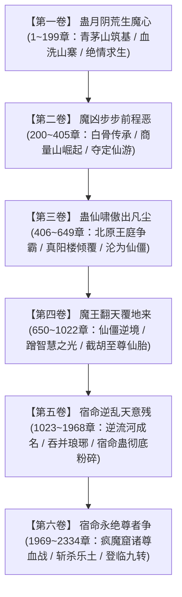

# 《蛊真人》全六卷主线剧情脉络编年

---

## 一、主线全卷宏观架构

《蛊真人》全书共六卷，字数逾450万字，完整讲述了主角古月方源在光阴逆流中重塑命运、掀翻宿命枷锁、登顶九转魔尊的史诗历程。

---

## 二、全六卷剧情深度拆解

### 第一卷：蛊月阴荒生魔心（1 ~ 199章）
* **主舞台**：南疆·青茅山·古月山寨
* **核心剧情**：
  * 方源前世五百年魔道老怪，在被名门正道围剿濒死之际自爆催动六转春秋蝉，重生回十五岁开窍大典。
  * 面对丙等资质的恶劣开局，方源利用前世经验算计族老、强占酒虫、巧取青茅山野外传承。
  * 结识十绝体（北冥冰魄体）天骄白凝冰，亦敌亦友。
  * 古月一代老祖尸变复苏，意图血祭全族后裔升仙。方源将计就计，抢先以血颅蛊血屠包括亲族在内的全寨活口，强行将自身资质拔升为甲等，借白凝冰自爆冰封之势杀出一条血路，逃离青茅山。

### 第二卷：魔凶步步前程恶（200 ~ 405章）
* **主舞台**：南疆蛮荒群山 $\rightarrow$ 白骨山 $\rightarrow$ 商量山 $\rightarrow$ 三叉山
* **核心剧情**：
  * 方源与化为女儿身的白凝冰结伴同行，历经艰险抵达白骨山，夺取灰骨才子白骨传承，炼成白骨肉生蛊。
  * 结识商心慈，护送商队抵达成南疆商贸圣地商量山。方源在演武场百战百胜，赢得极高身价与紫荆令牌。
  * 三叉山三王传承出世，天下四五转强者云集。方源在天时地利绝境下，于群仙神念窥伺的大战中心，行险招就地逆天炼制六转神蛊——**定仙游**！
  * 炼成瞬间催动定仙游，刹那间穿梭空间直达中洲天梯山，一举夺下**狐仙福地**，震惊五域！

### 第三卷：蛊仙啸傲出凡尘（406 ~ 649章）
* **主舞台**：中洲狐仙福地 $\rightarrow$ 北原苍茫大草原
* **核心剧情**：
  * 继承狐仙福地与荡魂山，贩卖胆识蛊大发横财，化解十大古派仙鹤门围攻。
  * 前往北原化名“狼王常山阴”，统御百万群狼参与北原王庭争霸，扶持黑楼兰横扫草原，入住王庭福地。
  * 潜入巨阳仙尊所留之中古至宝**八十八角真阳楼**，探寻无上机缘。
  * 巨阳意志苏醒，中洲天庭蛊仙降临，天下皆敌。方源联合黑楼兰与白凝冰，悍然引爆真阳楼与王庭福地！
  * 在巨阳意志疯狂追杀与太古荒兽围攻下，方源绝境服下借道死蛊，**舍弃肉身转化为死窍仙僵**，侥幸逃生。

### 第四卷：魔王翻天覆地来（650 ~ 1022章）
* **主舞台**：狐仙福地 $\rightarrow$ 东海 $\rightarrow$ 星宿洞天 $\rightarrow$ 南疆义天山
* **核心剧情**：
  * 方源以六转仙僵之躯在宝黄天翻云覆雨，利用仙僵寿命为零的死寂状态，肆无忌惮沉浸在九转智慧蛊的光晕中，推演无数仙蛊残方与极品杀招。
  * 探索各大福地，斩获东方长凡智道真传、繁星洞天资源。
  * **义天山巅峰大决战**：影宗与天庭在南疆义天山展开决定天地命运的赌局。天庭发动监天塔，而幽魂魔尊本体跨出生死门，以十绝仙僵大阵耗费十万年精血炼成古往今来第一逆天神蛊——**九转至尊仙胎蛊**。
  * 方源发现自己自始至终皆是天意的弃子与提线木偶；在千钧一发之际，方源果决神魂出窍，在幽魂夺舍前**抢先一步灵魂入驻至尊仙胎蛊**，重塑完美神体，从棋子逆袭为掀桌者！

### 第五卷：宿命逆乱天意残（1023 ~ 1968章）
* **主舞台**：五域两天大世界 $\rightarrow$ 天庭宿命大战
* **核心剧情**：
  * 方源凭借无冲突仙体极速成长，在北原雪灾大战中肉身走通**逆流河**，独创杀招逆流护身印，名扬五域。
  * 继承紫山真君遗产成为影宗新宗主；吞并琅琊福地，尽收毛民炼道底蕴。
  * **宿命大战（全书战力与谋略巅峰篇章）**：中洲炼蛊大会开启，天庭企图完全修复九转宿命蛊。方源联手长生天、四域散仙及异人联军，大闹天庭，力斩天庭宿老。
  * 凤九歌在最后关头高唱《命运歌》，方源以大无畏之道心，**一掌将九转宿命蛊彻底捏爆粉碎**！宿命彻底断绝，天下万灵重获自由意志，尊者时代再临。

### 第六卷：宿命永绝尊者争（1969 ~ 2334章 / 现存尾声）
* **主舞台**：五域合一大世界 $\rightarrow$ 疯魔窟第九层世界
* **核心剧情**：
  * 五域界壁因地脉相通彻底消散，天下融为一体。
  * 方源化身气海老祖一统东海，收割各方资源。
  * **疯魔窟大决战**：无极魔尊推演永生之局浮出水面。星宿仙尊、巨阳仙尊先后复生归来；乐土仙尊试图转修天道复生；幽魂魔尊沦为杀戮狂魔。
  * 方源于绝境中冷酷背刺并彻底击杀乐土仙尊，尽夺其天道道痕与无上积累。
  * 方源正式破境登顶九转，自命为**“炼天魔尊”**（对外伪称慈悲仁爱的**“大爱仙尊”**）。
  * 终局对峙：星宿、巨阳、方源三尊并立，角力天下，全书在此定格（因不可抗力停更）。

