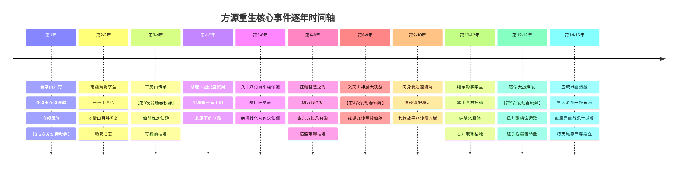

# 《蛊真人》全剧情完整时间线编年史（纯文字典藏版）

---

## 序章：纪元历法与时间维度说明

《蛊真人》世界的时间脉络宏大而严密，主要分为三大时间坐标系：
1. **蛊界远古通史（三百万年十尊纪元）**：从人祖出世，历经太古、远古、中古、近古四大历史大纪，共十位无敌九转尊者相继执掌天地。
2. **主角古月方源前世五百年（第一世）**：穿越降临、资质受困、颠沛流离、转修血道、登临六转，最终在五域正道围攻中自爆春秋蝉。
3. **方源重生后今生编年史（正文第一卷至第六卷）**：从十五岁青茅山开窍，历经五次春秋蝉时空回溯，打破天意操弄与宿命枷锁，直至疯魔窟成尊鼎立。

---

## 第一编：蛊界远古通史编年（三百万年大势纪）

### 【人祖纪元】（史前混沌时期）
* **人祖降生**：天地初辟，万籁俱寂，人祖在蛮荒大地上孤身一人苏醒，象征“人道”始源。
* **遭遇困境与遇蛊**：人祖直面【困难】与【绝望】野兽的围杀，先后邂逅【规】蛊与【矩】蛊立下规矩；在绝望深渊底部收纳【希望蛊】，奠定人族修行开窍之根基。
* **力量与智慧的价码**：人祖以青春为代价向【力量蛊】换取蛮力，以寿命为代价向【智慧蛊】换取智谋。
* **人祖十子诞生与十绝体起源**：
  * 人祖左眼化为长子【太日阳莽】；
  * 右眼化为次女【古月阴荒】；
  * 其余身躯骨血情感化为三子【北冥冰魄】、四女【森海轮回】、五子【炎煌雷泽】、六女【万金妙华】、七子【大力真武】、八女【逍遥智心】、九子【厚土元央】、十子【宇宙大衍】。
  * 十子在红尘与天意中相继惨烈夭折，其至纯道痕在人族血脉中留存，衍生为名震后世的“十绝体”。
* **踏足生死门与逆流河**：长子太日阳莽陨落，人祖独闯生死门，在逆流河中只差最后一步功亏一篑，太日阳莽魂飞魄散。
* **宿命被创**：太日阳莽在生死沉沦中催动【爱蛊】，炽烈情爱生生啄裂【九转宿命蛊】一角。
* **人祖之死**：人祖寻得【自我蛊】，在看破世态炎凉后肉身解体，魂魄归入大千天地。

---

### 【太古时代】（距今约300多万年前）
* **原始仙尊即位（气道始祖）**：
  * 人族第一位九转尊者。终结异人对人族的奴役统治，带领人族走向天地主宰。
  * 开创蛊师空窍开窍法、仙凡升阶体制，于中洲创立三百万年不朽之基——【天庭】。
  * 寿命悠长，于天庭积攒浩瀚元气与百万仙元，平定天下异人叛乱。
* **星宿仙尊即位（智道、星道始祖）**：
  * 天庭第二任掌舵人，原始仙尊衣钵真传。
  * 察觉天意对人族的制衡与异人反扑之险，晚年毅然选择**以身合天道**，以自身神魂意志同化天意三百万年，使天地意志长期偏袒人族、护佑天庭。
  * 设下三大算计棋局，分别针对后世无极、狂蛮、幽魂三位魔尊。

---

### 【远古时代】（距今约100多万年前）
* **无极魔尊即位（律道始祖）**：
  * 远古第一尊，人族历史上第一位魔道九转至尊。
  * 性格冷峻求真，严谨执着，毕生唯一执念为求索【永生】。
  * 独闯天庭，与合道状态下的星宿仙尊下棋博弈数百年，借天庭底蕴于北原深处布设【疯魔窟九层大阵】，推演天道衍生与长生解脱之法。
* **狂蛮魔尊即位（变化道、力道始祖）**：
  * 远古第二尊，行事霸烈豪迈，纯粹肉身力量之巅。
  * 崇尚“真男人赤膊搏杀，变化道才是真正的浪漫”。太古九天在其翻手之间被打碎三层，无数太古荒兽化为图腾，留下北原诸多狂蛮真传。
* **红莲魔尊即位（宙道始祖）**：
  * 远古第三尊，本为天庭宿命内定仙尊、龙公关门弟子。
  * 因至亲父母、挚爱妻子被所谓“天道宿命”强行夺走性命，决然反出天庭。
  * 炼就古往今来第一逆流奇蛊——【春秋蝉】，在宙河中逆流重生数千次。最终虽未能彻底灭亡宿命蛊，却将其再次砸碎重创，在宙河深处留下数座【石莲岛】，为后世百万年后方源砸碎宿命蛊留下关键火种。

---

### 【中古时代】（距今数十万年前）
* **元莲仙尊即位（木道始祖、画道开创者）**：
  * 中古第一尊，天庭第三任大当家。
  * 掌控天下生生不息之生机，创立中洲十大古派之【天莲派】。
  * 秘密创下隐匿流派【画道】，留下无上至宝《众生图》与帝君神木，暗度陈仓为天庭留存海量英灵复生底牌。
* **盗天魔尊即位（偷道始祖、宇道大成者）**：
  * 中古第二尊，来自异界高科技机械文明的【天外之魔（穿越者）】。
  * 视蛊界为残酷囚笼，终其一生只想“打破世界晶壁，回家”。
  * 行事机巧莫测，自创神偷手段与【空绝传承】，与长毛老祖赌胜炼制机甲，留下“神不知”、“鬼不觉”两大天外绝世杀招。
* **巨阳仙尊即位（运道始祖）**：
  * 中古第三尊，北原【长生天】创立者。
  * 创立自身运、众生运、天地运三大运道分支，坐拥镇运天宫。
  * 风流好色，后宫佳丽三千，子嗣遍布北原，确立“黄金血脉”万世统治；于北原铸造【八十八角真阳楼】，借十年大雪灾垄断天下野外仙蛊与资源。

---

### 【近古时代】（距今数万至十万年前）
* **幽魂魔尊即位（魂道始祖）**：
  * 近古第一尊，蛊界杀性最盛、最恐怖之至尊，信奉“唯杀可平万物”。
  * 创立覆盖五域的地下绝密组织【影宗】与掩护外壳【僵盟】。
  * 肉身陨落后潜伏于生死门数十万年，集结七大分魂与天下十绝仙僵，谋划终极逆天之作——【九转至尊仙胎蛊】。
* **乐土仙尊即位（土道、人道始祖，转修天道）**：
  * 近古第二尊，历史上唯一一位**一生未杀一灵**的慈悲圣王。
  * 行走五域抚平幽魂魔尊遗留的滔天杀孽，设立诸多乐土福地庇护异人与弱小族群，晚年参悟天道，布局后世重生。

---

## 第二编：古月方源前世五百年编年（第一世）

* **第0年（地球穿越）**：
  * 地球学者方源灵魂穿越至南疆青茅山，降生于古月一族支系，自幼聪慧超群，作诗文抄公名动山寨。
* **第15岁（开窍大典）**：
  * 方源被寄予厚望，却在大典上测出仅有【丙等资质（四成四元海）】，天差地别，瞬间从神坛跌落深渊，体会世态炎凉；胞弟古月方正觉醒甲等资质，二人命运逆转。
* **第16~25岁（青茅山沦陷与流亡）**：
  * 青茅山爆发罕见狼潮灾厄，古月山寨破灭。方源侥幸生还，沦为流民乞丐，后加入商队担任底层杂役，辗转南疆各寨。
* **第26~100岁（红尘摸爬滚打）**：
  * 方源在商量山等各大城池经商、当伙计、涉险荒野捕猎，历经无数出卖、构陷与险境，心性逐渐剥离软弱虚伪，铸就纯粹魔心。
* **第100~200岁（东海奇缘与绝情道心）**：
  * 穿越界壁前往东海，化身散修小商贩，结识鲛人一族，与鲛人圣女【谢晗婼】相知相恋。
  * 谢晗婼在鲛人王庭残酷的政治角力中被害惨死，方源深刻领悟到凡俗弱者的悲哀，发出“唯有求索无上大道方为真实”的誓言，道心彻底圆满，从此视万物为刍狗。
* **第200~300岁（转入血道与登临六转）**：
  * 转战西漠与北原，偶然继承【血海老祖】部分真传，转修速成且极度嗜杀的血道。
  * 经历天地灾劫，九死一生成功登仙，成为南疆名震一时的六转血道蛊仙，建立【血翼魔教】。
* **第300~450岁（乱世沉浮与寿元危机）**：
  * 五域界壁因地脉异动出现衰退征兆，天庭暗中插手五域大势，天下动荡。
  * 方源寿命将尽，因无寿蛊可用，被逼入绝境，多方搜罗红莲魔尊遗留的宙道残卷，萌生溯流光阴之狂念。
* **第450~500岁（逆炼春秋蝉与绝地自爆）**：
  * 方源隐伏万寿山数十年，耗费海量仙材与自身全部底蕴，终于逆天炼成六转宙道仙蛊【春秋蝉】。
  * 中洲天鹤上人、铁家铁面神、武家等天下正道群仙结成围剿大军，将方源围困于万寿山绝顶。
  * 方源面无惧色，冷笑长啸，当场自爆肉身神魂，将毕生记忆注入春秋蝉，溯流宙河逆光阴而上！

---

## 第三编：方源重生后今生编年史（正文第1~2334章逐年详析）

---

### 【第1年（方源15岁）】第一卷：青茅山筑基与血夜叛逆
* **【第1次春秋蝉发动生效】**：方源意识溯流五百年，在青茅山古月山寨十五岁开窍大典前夜醒来。
* **开窍与夺宝**：测得丙等资质，但从容不迫；算计族人巧取酒虫，暗中探明花酒行者水帘洞遗藏，取得白豕蛊、四味酒虫与藏宝图。
* **学堂称雄**：依靠前世搏杀经验击败古月方正等同辈，成为学堂班长；暗中利用青铜真元与酒虫淬炼，突破至二转。
* **狼潮大劫爆发**：青茅山三寨（古月、白家、熊家）联合抗击惨烈狼潮，方源浑水摸鱼斩杀熊家蛊师夺得大量资源。
* **白凝冰绝境**：十绝体北冥冰魄体濒临爆窍，方源与其斗智斗勇。
* **古月一代尸变与【第2次发动春秋蝉】**：
  * 古月一代老祖尸变复苏，意图血祭全族复生；天鹤上人降临，战局瞬间失控，方源濒死被迫发动春秋蝉回溯数天前。
  * 重生归来的方源将计就计，果断用血颅蛊亲手屠灭古月全族凡人血亲，将自身资质强行拔升至**甲等九成九**！
  * 诱导白凝冰自爆极寒冰封全山阻绝强敌，方源破冰而出，带着化为女身的白凝冰踏上逃亡之路。

---

### 【第2~3年（方源16~17岁）】第二卷前期：南疆荒野与商量山崛起
* **白骨山得真传**：穿越十万大山，在白骨山机关算尽，斩杀白骨才子残魂，夺取白骨真传，炼成三转【骨肉生生蛊】。
* **结识商心慈**：化名“宗九”，加入商心慈商队，沿途斩杀南疆各路山匪荒兽，暗中扶持商心慈化险为夷。
* **商量山演武称雄**：
  * 抵达成南疆商贸圣地商量山，入住商家城。
  * 参加演武场死斗，连破数十位强敌，以百战全胜战绩震慑南疆，获得商燕飞赠予的尊贵【紫荆令】。
  * 修为突破至四转中阶，暗中采购大量珍稀蛊材，备战三王传承。

---

### 【第3~4年（方源17~18岁）】第二卷后期：三王争霸与夺取狐仙福地
* **进驻三叉山**：南疆犬王、铁王、巫王三大五转古修传承出世，天下群雄汇聚。
* **白凝冰暗中反水与【第3次发动春秋蝉】**：
  * 白凝冰暗中勾结南疆正道铁家（铁若男、铁刀苦等），布下天罗地网将方源生擒逼入绝境。
  * 方源在濒死一刹那果决引爆春秋蝉，时间回溯至三王福地推演中盘！
* **众目睽睽下的仙前炼蛊**：
  * 方源神机妙算，抢占天时，以神游蛊、碧空蛊等为材料，在正魔四五转群仙杀招轰鸣中，当众逆天炼出六转仙蛊——【定仙游】！
* **空降天梯山夺福地**：
  * 仙蛊成型刹那，方源催动定仙游，跨越数万里界壁空降中洲天梯山。
  * 抢在中洲十大古派天骄凤金煌之前，通过狐仙遗留考验，正式成为【狐仙福地】新主人，坐拥天下第一壮魂圣地——【荡魂山】。

---

### 【第4~5年（方源18~20岁）】第三卷前期：中洲立足与化名潜入北原
* **垄断胆识蛊贸易**：在狐仙福地击退十大古派仙鹤门第一波偷袭，将太古毛民魂魄砸碎于荡魂山，全天下独家批量产出胆识蛊，在宝黄天引起轰动，日进斗金。
* **北原五年潜伏计划**：
  * 鉴于中洲天庭与各大古派严密盯防狐仙福地，方源借助定仙游秘密潜入北原。
  * 伪造身份，化名为北原失踪多年的五转奴道大师【狼王常山阴】。
* **征战王庭争霸**：
  * 驯服白眼狼王，统御百万狼群，与黑家少主黑楼兰（大力真武体）结为核心盟友。
  * 席卷北原大草原，连克马尊、耶律家联军，助黑家成功进驻【王庭福地】。

---

### 【第5~6年（方源20~22岁）】第三卷后期：真阳楼崩塌与舍身化仙僵
* **渗透八十八角真阳楼**：潜入巨阳仙尊立下的中古至宝真阳楼，依靠智慧推演破解数百层关卡，暗中掠夺无尽机缘与运道传承。
* **真阳楼倾覆大灾厄**：
  * 方源联合黑楼兰、太白云生，强行引爆真阳楼核心地脉；巨阳仙尊残存意志暴怒苏醒。
  * 王庭福地彻底破灭，虚空乱流呼啸，中洲与北原多名蛊仙降临绞杀。
* **断尾求生化仙僵**：
  * 在肉身神魂即将被太古荒兽与巨阳意志撕碎的绝命一刻，方源服下借道死蛊，断绝全身生机，将自身强行转化为【六转死窍仙僵】！
  * 凭借定仙游与太白云生接应，侥幸逃出生天。

---

### 【第6~8年（方源22~24岁）】第四卷前期：仙僵逆境求生与蹭智慧之光
* **智慧蛊奇迹**：
  * 仙僵肉身已死，寿命为零。方源在狐仙福地惊喜发现九转【智慧蛊】，因无法扣除其寿命，得以毫无顾忌地狂蹭智慧之光。
  * 灵感呈亿万倍爆发，修复海量古代失传仙蛊方，推演自创惊世杀招——【万我】！
* **暗流涌动**：
  * 结识太古毛民圣地【琅琊福地】地灵，与其达成深度合作。
  * 探索繁星洞天、星宿洞天遗迹，夺取北原东方长凡智道全套真传。
  * 潜入东海僵盟，暗中查探复生之法，逐渐触及“影宗”与“生死门”的万古黑幕。

---

### 【第8~9年（方源24~26岁）】第四卷后期：义天山巅峰博弈与夺舍仙胎
* **义天山赌局开启**：天庭与影宗在南疆义天山布下毁灭性大局。影宗耗费十万年基业，献祭全天下十绝仙僵，秘密开炉炼制九转神物——【至尊仙胎蛊】。
* **天意操弄与【第4次发动春秋蝉】**：
  * 天庭监天塔九转杀招轰顶，方源作为天意遏制幽魂的“棋子”战死，第四次催动春秋蝉溯流时空。
  * 在红莲魔尊意志暗中加持下，方源脱离天意摆布。
* **惊天逆转·截胡仙胎**：
  * 在至尊仙胎蛊出炉的一刹那，方源抢在重伤的幽魂本体之前元神出窍，悍然钻入仙胎之中夺舍重生！
  * 方源获得完美无瑕的【至尊仙体（万道不互斥体质）】，影宗十万年积蓄尽入方源囊中，幽魂魔尊沦为疯魔。

---

### 【第9~10年（方源26~27岁）】第五卷前期：逆流河成名与名震五域
* **仙体蜕变**：至尊仙体具有小五域和小九天，吞并外界福地可直接跨过灾劫并继承全部道痕，修行速度神速。
* **北原雪灾逆流河之战**：
  * 天庭与五域八转大能（雪胡老祖、中洲追兵）联手围堵方源于北原大雪山。
  * 方源被逼坠入绝地秘境——【逆流河】。在河中万蛊沉寂、只能肉身行走的绝境中，方源凭借五百年坚不可摧的道心，在万仙注视下一步步趟穿逆流河！
  * 独创八转防御神技——【逆流护身印】（反弹世间一切攻伐），以七转修为硬抗八转强敌毫发无损，名动天下。

---

### 【第10~12年（方源27~29岁）】第五卷中期：执掌影宗与吞并琅琊福地
* **紫山真君悲壮托孤**：南疆超级梦境大战中，影宗第一分魂紫山真君战死于泥泞，临终前将影宗全盘底蕴托付给方源，方源正式加冕为【影宗新任宗主】。
* **梦求真探索万道真意**：
  * 研制出第十一绝体——【纯梦求真体】，作为分身梦求真的肉身，不惧梦境同化，大肆汲取全流派境界真意。
* **吞并琅琊福地**：天庭凤九歌、陈衣多次突袭琅琊福地，方源在最关键时刻力挽狂澜，将琅琊福地完整吞入至尊仙窍，炼道境界正式跨入【无上大宗师】门槛。

---

### 【第12~13年（方源29~31岁）】第五卷末期：决战宿命与天道枷锁尽碎
* **潜伏中洲炼蛊大会**：天庭企图在中洲炼蛊大会彻底修复九转宿命蛊，重演万古统治。
* **【第5次发动春秋蝉】**：
  * 第一次反攻天庭失败，龙公战力滔天，方源本体喋血战死，其宙道分身何春秋在宙河深处第五次引爆八转春秋蝉！
  * 方源重回大战前夕，成功策反凤九歌并取得关键真传。
* **宿命决战与毁蛊封神**：
  * 方源率领长生天、四域散仙与异人联军总攻天庭腹地。
  * 龙公燃烧寿元施展“九转归虚”，凤九歌唱响超脱宿命的《命运歌》。
  * 方源杀至监天塔顶端，**徒手将九转宿命蛊生生捏爆粉碎**！
  * 宿命彻底破灭，天道有缺，众生挣脱命运枷锁，五域迎来尊者复苏大乱世。

---

### 【第14~16年（方源32~34岁）】第六卷（现存末卷）：五域合一、疯魔窟大决战与炼天成尊
* **五域融为一体**：地脉彻底复苏，五域界壁消融消失，九天塌缩为白天与黑天，大世降临。
* **气海老祖与吴帅纵横**：方源分身气海老祖以太古气道泰斗身份一统东海；分身吴帅掌控龙宫号令两天异人联盟。
* **疯魔窟第九层诸尊大决战**：
  * 无极魔尊演算百万年的永生之局浮出水面，最终永生失败身死道消。
  * 星宿仙尊、巨阳仙尊先后从沉睡与假死中完全复苏，重现九转无敌战力。
  * 乐土仙尊试图转修天道复生成尊。
* **背刺乐土与成尊时刻**：
  * 方源在绝境中展现极致魔头手段，冷酷背叛盟约，与星宿、巨阳合力诛杀乐土，方源更将乐土全副天道道痕与真意吞噬殆尽！
  * 方源打破三次混沌大劫，以无上炼道正式登临**九转尊者**之位！号【炼天魔尊】（对外厚颜自封为拯救苍生的“大爱仙尊”）。
* **全书定格（停更点）**：
  * 星宿仙尊（天庭）、巨阳仙尊（长生天）、大爱仙尊方源（大爱盟）三尊并立，角逐全天下资源与永生真谛。
  * 故事在此处因不可抗力定格，留下了网文史上最为波澜壮阔的未竟史诗。

---

## 第四编：春秋蝉回溯时空节点专项对照表

| 发动序列 | 发动时修为与状态 | 致命起因与绝境 | 回溯时间跨度 | 原历史走向（已抹除） | 重生后新历史走向（正文世界线） |
| :---: | :---: | :---: | :---: | :---: | :---: |
| **第1次** | 六转血道魔仙（五百岁） | 万寿山遭五域正道大军围剿濒死 | 逆流光阴**五百年** | 方源自爆陨落，第一世魔教生涯终结 | 重回15岁开窍大典，开启正文重修神话 |
| **第2次** | 三转蛊师（青茅山时期） | 古月一代尸变血祭与天鹤上人降临绝杀 | 回溯数天前 | 青茅山三寨灭绝，方源与白凝冰惨死 | 提前布局用血颅蛊屠灭全族，资质跃升甲等九成九逃逸 |
| **第3次** | 四转巅峰（三叉山时期） | 白凝冰暗通铁家背刺，身陷铁血牢笼 | 回溯数月前 | 三王福地破灭，方源被铁家生擒羁押 | 运筹帷幄反制白凝冰，众目睽睽下炼出定仙游空降狐仙福地 |
| **第4次** | 六转仙僵（义天山时期） | 监天塔九转神威轰顶，方源被天意算计 | 回溯至决战前夕 | 幽魂魔尊夺舍仙胎重生，方源沦为弃子灰飞烟灭 | 破除天意迷障，神魂出窍截胡九转至尊仙胎蛊成功夺舍 |
| **第5次** | 八转准尊（宿命大战） | 龙公燃烧寿元爆发九转威能，本体陨落 | 宙道分身何春秋回溯至大战中盘 | 宿命蛊彻底修复，天庭重掌天下，反抗联军全灭 | 策反凤九歌唱《命运歌》，方源杀入监天塔单手捏碎宿命蛊 |
