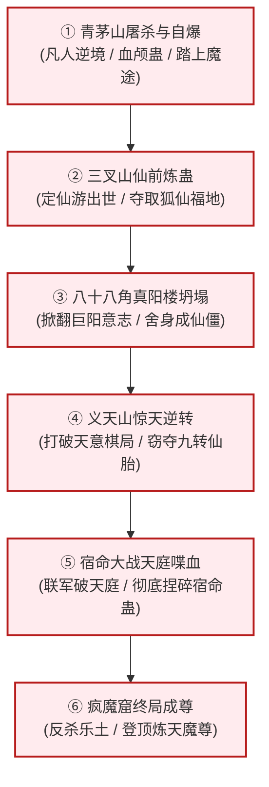

# 《蛊真人》史诗战役与惊天转折深度详解

---

## 一、六大决定命运的史诗战役

《蛊真人》之所以情节跌宕起伏，核心在于作者构筑了数场谋略深沉、战力滔天、反转惊人的旷世决战。每一场战役都彻底改写了天下大势。

---

## 二、六大战役详细进程与博弈复盘

### 战役一：青茅山血色终局 —— 魔心铸就，斩断俗缘
* **交战双方**：古月方源 vs 古月一代老祖 vs 白凝冰 vs 鹤风扬（暗中窥伺）
* **战役背景**：方源重生后依靠信息差累积优势，古月一代复苏欲拿全族献祭以延寿突破。
* **致命杀招与博弈**：
  * 一代老祖施展血海秘法，将族人视为血食。方源冷酷无情，趁乱挥动屠刀，亲自以血颅蛊斩杀数十位血亲，将自身丙等资质强行淬炼至甲等九成九。
  * 白凝冰十绝体濒临爆窍自爆，方源利用其追求“精彩”的心理，诱使其自愿彻底爆发全身冰魄元海，冰封整个青茅山数里方圆，将追兵与一代老祖尽数冻结。
* **战役结局**：方源携带奄奄一息的白凝冰破冰而出，踏出南疆大山，从此彻底告别凡俗伦常。

### 战役二：三叉山夺宝 —— 众目睽睽下的仙前炼蛊
* **交战双方**：方源 vs 三叉山各路正魔四转五转强者（铁刀苦、易冲天、况狂生等）
* **战局危殆**：三王传承福地行将破灭，中洲蛊仙仙鹤门正在高空俯瞰夺地。方源修为仅四转，面临十面埋伏。
* **惊天妙手**：
  * 方源计算天时地利，以自身记忆为柴薪，以神圣光景为引，在无数强者的攻击洪流包围中，神色平静地当场架炉炼制六转仙蛊**定仙游**。
  * 在仙蛊成型的万丈霞光中，方源口含真元一口吞下仙蛊，在群仙贪婪暴怒的巨手抓来前一刹那，催动定仙游凭空消失，跨域空降中洲天梯山，稳稳摘取狐仙福地。

### 战役三：八十八角真阳楼倾覆战 —— 掀翻万载祖宗基业
* **交战双方**：方源、黑楼兰、白凝冰 vs 巨阳仙尊残存意志、马鸿运、天庭黑楼兰追踪者
* **惨烈程度**：
  * 八十八角真阳楼乃巨阳仙尊留给后世子孙万代的至尊底牌。方源深入楼心，破解无数关卡，直接动摇了整个王庭福地的地基。
  * 巨阳意志暴怒苏醒，调动无尽仙蛊如暴雨般轰击方源。
  * 在王庭福地全面崩溃、虚空乱流撕裂一切的绝境下，方源自知肉身必死，决然服下“借道死蛊”，将自己转化为毫无生机的**死窍仙僵**。
* **深远影响**：北原黄金家族万载象征被彻底夷为平地，北原迎来数万年未有之大动荡。

### 战役四：义天山神魔对弈 —— 棋子撕碎棋盘，截胡仙胎
* **交战双方**：天意（借方源之手）、天庭 vs 幽魂魔尊本体、影宗诸仙僵
* **幕后黑手之争**：
  * 天庭监天塔锁定义天山，影宗十万年积蓄在此一搏，以十绝仙僵大阵炼制逆天之物“至尊仙胎蛊”。
  * 天意原本将方源当做纯粹的除魔工具人，操纵方源携带春秋蝉阻击幽魂。
* **反转再反转**：
  * 在九转至尊仙胎蛊出炉的一瞬间，幽魂本体因重创动作稍慢半息；
  * 方源识破天意险恶阴谋（天意意图在消灭幽魂后顺手将方源一同抹杀），他没有听从天意安排摧毁仙蛊，而是**元神出窍，悍然钻入九转至尊仙胎蛊中夺舍重生**！
  * 仙胎初成，方源赤身走出光晕，幽魂十万年心血尽归方源囊中。

### 战役五：宿命大战 —— “万载枷锁，今朝尽碎！”
* **交战双方**：方源（率领南疆、北原、西漠、东海反天庭联军） vs 中洲天庭（龙公、星宿意志、十大古派）
* **巅峰对抗**：
  * 天庭企图借中洲炼蛊大会彻底修补九转宿命蛊，重掌天下众生杀伐大权。
  * 方源数次动用春秋蝉回溯推演，联合长生天七极圣仙、武庸、龙宫、万仙攻入天庭腹地。
  * 龙公燃烧寿元爆发九转战力，横推万仙；凤九歌在关头顿悟，唱出惊天地泣鬼神的《命运歌》，重创天庭道心。
  * 方源凭借万我与至尊之躯，顶着无数天道劫云，强行杀至监天塔之巅，**当着全天下五域蛊仙的面，单手捏爆九转宿命蛊**！
* **历史定格**：宿命既亡，天道有缺，尊者时代再无枷锁。

### 战役六：疯魔窟终极杀局 —— 炼天成尊
* **交战双方**：方源 vs 星宿仙尊 vs 巨阳仙尊 vs 乐土仙尊 vs 幽魂魔尊 vs 无极魔尊残灵
* **惨烈博弈**：
  * 无极魔尊推演永生失败身死，原初境与天地熔炉爆发。
  * 星宿与巨阳先后复生，展现九转无敌之神威，各施智道、运道神通压制全场。
  * 乐土仙尊欲修天道复生成尊，以仁义拉拢方源。
  * 方源在最关键时刻展现究极魔头本色，背叛盟约，与巨阳、星宿合力击杀乐土，方源更亲手吞噬乐土全部遗产与天道真意。
* **封神时刻**：方源借天地熔炉与疯魔窟无尽道痕，突破混沌大劫，正式成尊！号**“炼天魔尊”**，开辟三尊鼎立之新纪元。

