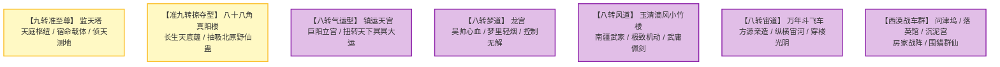

# 《蛊真人》仙蛊屋与仙道战争堡垒全录

---

## 一、仙蛊屋在蛊界战争中的终极地位

仙蛊屋是蛊界工业文明与阵道科技的最高结晶。它将多只仙蛊（甚至核心九转/八转仙蛊）与数十万至上百万只凡蛊精密搭接，形成集**移动要塞、协同施法、全方位道痕防御、仙元集中放大**于一体的战略核威慑力量。

---

## 二、绝世与战略级仙蛊屋深度详谱

### 1. 【监天塔】（Heaven Overseeing Tower）—— 天庭至尊中枢
* **位阶与归属**：九转仙蛊屋，中洲天庭第一牌面与指挥中枢。
* **核心构成**：九转【宿命蛊】为眼，辅以大量智道、天道、律道仙蛊。
* **战略威能**：
  * **监察大千**：时刻监视全五域九天一切道痕异动、仙蛊诞生与魔修因果。
  * **宿命裁决**：引动宿命威能降下不可违逆的天道抹杀劫光，直接削减敌对仙尊与群仙气数命格。
* **最终战史**：宿命大战中，监天塔被方源联军浴血强攻打破外壳，方源踏上塔顶亲手捏碎宿命蛊，监天塔半毁。

### 2. 【八十八角真阳楼】（Eighty-Eight True Yang Building）—— 北原黄金掠夺机
* **位阶与归属**：准九转仙蛊屋，巨阳仙尊亲手铸造于北原王庭福地。
* **运作机制**：
  * 八十八层塔楼，每层对应北原各大黄金家族血脉机缘。
  * **天灾吸蛊机**：每十年北原大雪灾降临，真阳楼自发汲取狂暴雪灾能量，强行将整个北原大地上的野生仙蛊与天地灵珍“抽吸过滤”送入楼中，成为巨阳后裔的私产。
* **终局**：方源第三卷末尾联合黑楼兰暗中破坏楼心阵眼，导致真阳楼地脉崩塌，彻底轰然倒塌夷为平地。

### 3. 【镇运天宫】（Calamity Luck Altar）—— 长生天气运神殿
* **位阶与归属**：八转顶级运道仙蛊屋，北原长生天的移动作战旗舰。
* **核心蛊虫**：巨阳仙尊亲传运道核心仙蛊群。
* **功能**：凝聚北原万千黄金后裔的气运，逢凶化吉；在宿命大战中充当长生天进攻天庭的先头破阵重锤，硬扛监天塔轰击。

### 4. 【龙宫】（Dragon Palace）—— 掌控梦境的绝代妖宫
* **位阶与归属**：八转梦道兼奴道仙蛊屋，中古龙人始祖吴帅为对抗天庭清洗而耗费毕生心血筑造。
* **核心杀招**：**【梦里轻烟】**。
  * 宫殿门开，轻烟袅袅散出，中招之八转蛊仙瞬间陷入昏睡梦境，任凭神兵仙术轰击亦无法自拔。
* **归宿流转**：东海现世引发群雄争夺，最终被方源施展偷天妙手夺得，成为方源分身吴帅掌控两天异人联军的核心旗舰。

### 5. 【玉清滴风小竹楼】（Clear Jade Dripping Wind Tiny Bamboo Building）—— 南疆极速利刃
* **位阶与归属**：八转风道仙蛊屋，南疆超级家族【武家】镇族至宝。
* **外形特征**：通体由翠绿欲滴的玉清仙竹构筑而成的两层雅致小楼，四周常年环绕着肉眼难辨的微风。
* **战力指标**：
  * **天下第一遁速**：在八转仙蛊屋中飞行机动速度位列极巅，瞬息万里。
  * **武庸合击**：武庸坐镇楼中，催动“清风剪”与“风声鹤唳”，可将仙道杀招威力放大数倍，曾在南疆内乱与宿命大战中连斩多位同阶八转强敌。

### 6. 【万年斗飞车】（Myriad Year Flying Warship）—— 宙河霸王战舰
* **位阶与归属**：八转宙道仙蛊屋，古月方源为征伐宙河、夺取红莲石莲岛真传而亲自设计炼制。
* **动力与特征**：
  * 由数十万只年蛊、月蛊、日蛊与数只八转宙道仙蛊构成。
  * 具备在宙河狂暴风浪与光阴漩涡中平稳破浪疾驰的神威，是方源在宙河大战中横扫天庭追击舰队（如四时行舟）的无上凶器。

---

## 三、各超级势力代表仙蛊屋全览表

| 势力阵营 | 仙蛊屋名称 | 核心主修流派 | 转数位阶 | 战略特色与代表功能 |
| :--- | :--- | :--- | :--- | :--- |
| **中洲天庭** | **监天塔** | 天道 / 智道 / 律道 | 九转 | 统御天庭，宿命神罚，推算天下大势 |
|  | **清心玉壶** | 智道 / 律道 | 八转 | 安定心神，净化魔念，审讯强敌 |
|  | **万年长明灯** | 光道 / 炎道 | 八转 | 破除黑暗遮蔽，大范围视野压制 |
| **北原长生天** | **镇运天宫** | 运道 | 八转顶峰 | 镇压北原气运，逆风翻盘，冲阵破敌 |
|  | **八十八角真阳楼** | 运道 / 奴道 / 律道 | 准九转（已毁） | 垄断全北原野外仙蛊与仙材资源 |
| **南疆武家** | **玉清滴风小竹楼** | 风道 | 八转 | 极致遁速，隐匿破空，攻防一体 |
| **南疆铁家** | **铁血楼** | 律道 / 金道 | 八转 | 移动空中监狱，镇压魔道，铁血审判 |
| **西漠房家** | **问津坞** | 宇道 / 水道 | 七转~八转 | 空间穿梭，沙海遁地，构建房家战阵 |
|  | **沉泥宫** | 土道 | 七转~八转 | 地底潜伏，吸纳大地道痕，坚壁清野 |
|  | **落英馆** | 木道 | 七转 | 百花飞舞，治疗辅助，困敌致幻 |
| **大爱盟(方源)** | **万年斗飞车** | 宙道 | 八转 | 宙河纵横，冲撞破阵，宙道杀伐 |
|  | **龙宫** | 梦道 / 奴道 | 八转 | 梦里轻烟入梦催眠，奴役太古荒兽 |
|  | **安土重山堡** | 土道 | 八转 | 极致厚重大地防御，化解尊者余波 |
