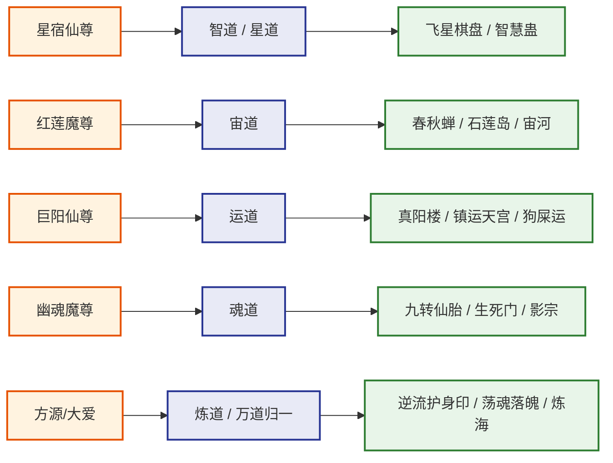
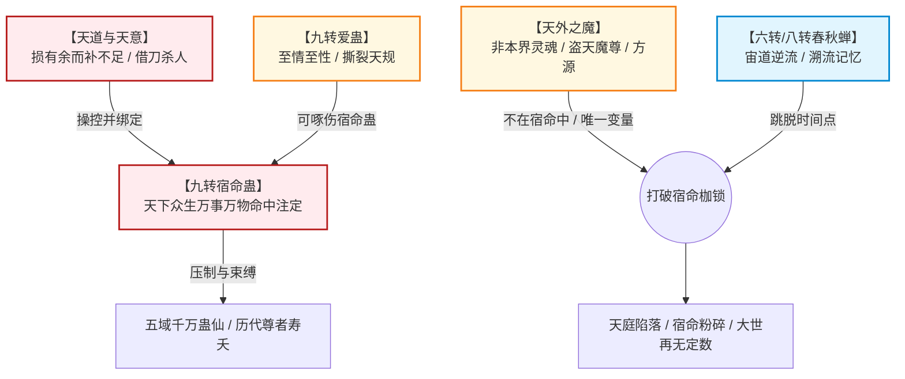

# 《蛊真人》全书核心要素多维交叉矩阵

---

## 一、历代九转尊者【流派-仙蛊-秘境-兵器-阵营】终极交叉矩阵

| 尊号 | 时代 | 主修/兼修流派 | 核心本命/代表仙蛊 | 专属天地秘境与战略战争兵器 | 所属圣地与阵营 | 终局归宿与万古后手 |
| :--- | :--- | :--- | :--- | :--- | :--- | :--- |
| **原始仙尊** | 太古第一尊 | 气道 | 气道核心仙蛊群 | 天庭气墙、浩瀚元气深潭 | 中洲·天庭创立者 | 寿尽陨落，暗留百万年浩然元气护持天庭底蕴 |
| **星宿仙尊** | 太古第二尊 | 智道 / 星道 | 智慧蛊、星念蛊 | 【仙蛊屋】飞星棋盘 | 中洲·天庭第二任掌舵 | 以身合天道300万年影响天意，疯魔窟大战首位复生复苏 |
| **无极魔尊** | 远古第一尊 | 律道 | 规矩蛊、排斥蛊 | 【天地秘境】**疯魔窟**（九层衍生世界） | 散修魔道始祖 | 潜入天庭博弈星宿，推演天地演化，疯魔窟终局永生失败道消 |
| **狂蛮魔尊** | 远古第二尊 | 变化道 / 力道 | 变异蛊、力道绝世蛊 | 狂蛮真传万兽图腾、吞天魔狼遗骸 | 散修无敌霸主 | 轰碎太古三天（赤/橙/黄），留下北原力道与变化道不朽火种 |
| **红莲魔尊** | 远古第三尊 | 宙道 | **春秋蝉**、岁月蛊 | 【天地秘境】**宙河**、石莲岛真传 | 原天庭预定仙尊，后反叛天庭 | 逆流光阴千百次击碎宿命蛊一角，为方源彻底毁蛊埋下关键火种 |
| **元莲仙尊** | 中古第一尊 | 木道 / 画道 | 帝君神木、画道仙蛊 | 【仙蛊屋】神帝天莲、画卷《众生图》 | 中洲·天莲派、天庭第三任掌舵 | 留下画道暗度陈仓，疯魔窟画卷展开复活无数中洲历代英灵 |
| **盗天魔尊** | 中古第二尊 | 偷道 / 宇道 | 偷天蛊、神不知鬼不觉 | 【仙蛊屋】空绝神甲、盗天机甲 | 异界穿越者（天外之魔） | 留空绝传承，追求“打破晶壁回家”，留给方源两大天外护身符 |
| **巨阳仙尊** | 中古第三尊 | 运道 | 自身运、狗屎运、众生运 | 【仙蛊屋】**八十八角真阳楼**、镇运天宫 | 北原·长生天开创者 | 遗留黄金血脉统治北原数万年，疯魔窟复生与星宿、方源三足鼎立 |
| **幽魂魔尊** | 近古第一尊 | 魂道 | **九转至尊仙胎蛊**、噬魂蛊 | 【天地秘境】**生死门**、荡魂山、落魄谷 | 暗黑霸主·影宗、僵盟 | 屠戮万灵以杀证道，十万年炼制九转仙胎被方源截胡夺舍，沦为疯魔 |
| **乐土仙尊** | 近古第二尊 | 土道/人道/天道 | 功德蛊、慈悲大愿 | 【天地秘境】南疆乐土、人海雏形 | 散修圣王、平抑五域杀孽 | 一生未杀一生灵，晚年谋算修天道，疯魔窟被方源冷酷背刺身死吸收 |
| **炼天魔尊** (古月方源) | 当代/大梦时代 | 炼道（九转） 兼修万派 | 至尊仙胎蛊、春秋蝉、智慧蛊、态度蛊、定仙游 | 【天地秘境】**逆流河**、**荡魂山**、**落魄谷**、**炼海**、**市井**、**人海** | 大爱盟盟主、齐天洞天主宰 | 徒手捏爆九转宿命蛊，斩乐土渡混沌大劫登临九转，三尊并立 |

---

## 二、人祖十子与十绝体及传承人物全映射矩阵

《人祖传》十子血脉神话与现世十绝体修行者存在一对一的因果映射。

| 人祖十子排行 | 十子神话起源 | 对应凡间十绝体 | 对应核心大道流派 | 原著代表人物/仙僵承载者 | 命运结局与剧情映射 |
| :---: | :--- | :--- | :--- | :--- | :--- |
| **长子** | 人祖左眼所化 | **太日阳莽体** | 宇道 / 光道 / 阳道 | 太日阳莽（神话） / 宇道天骄仙僵 | 狂傲自负，在生死门沉沦，最终因爱蛊而亡 |
| **次女** | 人祖右眼所化 | **古月阴荒体** | 宙道 / 月道 / 暗道 | 影无邪（初代肉身） / 古月一族古祖 | 与长子相依为命，衍生南疆古月氏血脉传承 |
| **三子** | 人祖心智坚冰 | **北冥冰魄体** | 冰雪道 / 魂道 | **白凝冰**（全书重要核心主角） | 青茅山自爆冰封群山；后被方源阴阳转生为女身，追寻极致精彩 |
| **四女** | 人祖生命生机 | **森海轮回体** | 木道 / 生生道 | 森海仙僵 / 太古木道散仙 | 拥有滔天生机恢复力，用于十绝仙僵大阵炼胎 |
| **五子** | 人祖怒火惊雷 | **炎煌雷泽体** | 炎道 / 雷道（复合） | 炎煌雷泽仙僵 | 毁灭攻伐极强，成为影宗炼制仙胎的雷炎核心火种 |
| **六女** | 人祖富贵华采 | **万金妙华体** | 金道 | 金晨曦 / 万金仙僵 | 极尽锋锐华美，提供至尊仙胎的金道底蕴 |
| **七子** | 人祖蛮力骨骼 | **大力真武体** | 力道 / 纯阳武道 | **黑楼兰**（北原少主，方源盟友） | 为弑父复仇女扮男装，力大无穷，后在方源麾下浴血征伐 |
| **八女** | 人祖机巧灵犀 | **逍遥智心体** | 智道 / 算计思虑 | 智仙子 / 影宗智道核心仙僵 | 拥有推演万物的智慧空窍，为十绝大阵提供精密运转 |
| **九子** | 人祖厚土承载 | **厚土元央体** | 土道 / 地脉承载 | 厚土仙僵 | 提供至尊仙窍稳定大地的根本载体 |
| **十子** | 人祖虚空衍生 | **宇宙大衍体** | 宇道 / 变化大衍 | 虚空大衍仙僵 | 赋予至尊仙胎海纳百川、空间无边无际的特性 |
| **【后天第十一绝】** | 影宗/方源后天人工研创 | **纯梦求真体** | **梦道**（未来至尊流派） | **梦求真**（方源纯梦求真分身） | 不惧梦境侵蚀同化，助方源肆意汲取天地梦境真意，跃升全流派境界 |

---

## 三、五域地缘政治与界壁排斥克制矩阵

五域界壁在宿命蛊破灭前，是横亘在蛊仙面前的不可逾越之堑；异域蛊仙越界作战将遭受严酷反噬与压制。

| 地理大域 | 界壁名称与自然特性 | 统治社会体制 | 领袖超级势力 | 区域代表流派 | 区域标志性战略资源/仙蛊屋 |
| :--- | :--- | :--- | :--- | :--- | :--- |
| **中洲** | **圣贤界壁** （文华浩然，凝重排斥，真元如陷泥沼） | **宗门公天下制** （择优录用，上升通道明晰） | **天庭** 中洲十大古派 | 智道、律道、气道、炼道 | 监天塔、飞星棋盘、神帝天莲、天梯山福地群 |
| **北原** | **苍炎界壁** （狂暴苍炎，烈焰焚身，极度剧烈痛楚） | **黄金血脉部落制** （巨阳遗训，胜者通吃，弱肉强食） | **长生天** 黄金家族（黑/刘/耶律等） | 运道、风道、力道、炎道 | 镇运天宫、八十八角真阳楼（已毁）、大雪山福地 |
| **南疆** | **瘴气界壁** （腐蚀毒瘴，侵蚀仙躯，剧烈消融气血） | **崇山家族寨子制** （各据险峰，血脉封闭，宗法森严） | **武家**（正道领袖） 铁家、商家、池家 | 土道、毒道、骨道、阵道 | 玉清滴风小竹楼、铁血楼、商量山城、十万大山仙阵 |
| **西漠** | **黄沙界壁** （狂沙漫天，消磨骨髓，神魂迷失） | **绿洲家族联盟制** （控制水源与黑油，商贸驼队） | **房家**（仙蛊屋世家） 萧家、万家、石家 | 炎道、土道、偷道、兵道 | 问津坞、落英馆、沉泥宫、极品黑油地脉 |
| **东海** | **蔚蓝界壁** （波涛汹涌，水压缠滞，阻力千重） | **海岛世家与散修共治** （物产丰饶，性情守成，偏好通商） | **宋家、华家、沈家** 后期统合为**气海/大爱盟** | 水道、云道、气道、食道 | 龙宫（八转梦道仙蛊屋）、白玉鲸、万年水产海沟 |

---

## 四、天道天意 vs 宿命蛊 vs 春秋蝉 vs 天外之魔：因果博弈机制全览

全书底层围绕“天道平衡”与“超越宿命”展开了惊心动魄的规则对抗。

1. **天意的运作逻辑**：
   * 天意不是具有人类七情六欲的神明，而是客观维护天地平衡的“冷酷机制”；
   * 其核心法则是“损有余而补不足”，谁过于强盛（如幽魂魔尊企图炼九转仙胎复生逆天），天意便通过灾劫、巧合、意志暗示，扶持弱者（借方源之手）充当棋子除掉强者。
2. **天外之魔的超脱特质**：
   * 来自地球或其他异世界的灵魂（如盗天魔尊、古月方源），其命格不在蛊界天道宿命图谱之中；
   * 只有“完全的天外之魔”（灵魂与肉身皆非本土原装，如至尊仙体+方源地球魂魄），才能真正出手**彻底捏碎宿命蛊**，本土蛊仙无论实力多强皆受法则压制无法毁蛊。
3. **春秋蝉的回溯法则**：
   * 溯流宙河以消耗自身气运为代价，由于红莲魔尊意志暗留宙河石莲岛，春秋蝉成为了天外之魔打破宿命循环的关键跳板。
