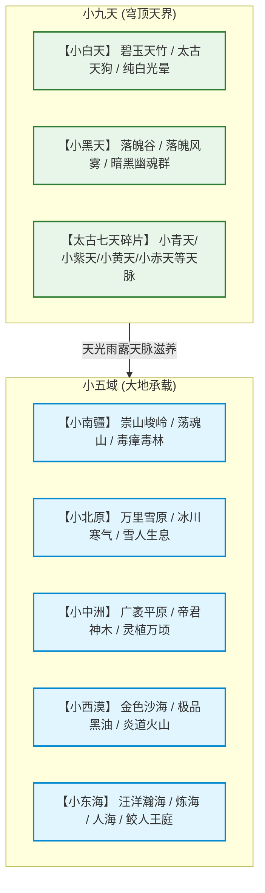
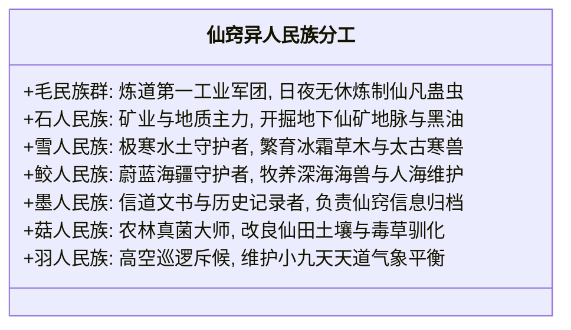

# 《蛊真人》至尊仙窍微观生态与资源全景图

---

## 一、至尊仙窍总体宏观构造

至尊仙窍是九转至尊仙胎蛊破而后立所开辟出的**世界级体内大洞天**。
其总面积超越五域常规八转洞天数万倍，甚至逼近真实五域之一的大小。其最大神异在于**道痕互不干扰排斥**，因此能够同时并存、繁衍万物生灵与天地万派极致奇观。

---

## 二、小五域地貌分布与核心天地秘境

### 1. 小南疆：十万群山与魂道源泉
* **地貌特征**：千峰竞秀，瘴气弥漫，怪石嶙峋。
* **镇守核心**：**【天地秘境·荡魂山】**。
  * 屹立于群山正中央，整座山通体泛着幽绿魂光。
  * **经济引擎**：方源每日将数万战俘、异人罪犯或上古荒兽的残魂投入山石，通过震荡源源不断凝结出纯净无瑕的**胆识蛊**，源源不断输送给宝黄天或充实自身神魂。
* **配套资源点**：五毒森林、白骨山丘陵、池家仙阵试验场。

### 2. 小东海：汪洋大海与两大至高秘境
* **地貌特征**：烟波浩渺，海沟万丈，群岛点缀。
* **两大终极秘境**：
  * **【天地秘境·炼海】**：方源晚年借长毛老祖长生手段与无尽仙材补全的炼道汪洋。海水全由最纯净的炼道道痕凝聚，万物入海皆可融炼化仙，是方源成尊后批次升炼八转仙蛊的母港。
  * **【天地秘境·人海】**：汇集亿万众生生机、凡人愿力与魂魄碎片的人道秘境，具备让战死仙仙与凡夫俗子断肢重生、复苏真身的逆天神效。
* **核心部族**：**鲛人王庭**。方源前世遗愿在此圆满，鲛人部族在小东海深海安居乐业，专门培育万年夜明珠、幽水藻与海兽骑兵。

### 3. 小北原：冰封雪原与极寒净土
* **地貌特征**：千里冰封，万里雪飘，寒风刺骨。
* **核心生灵**：**雪人一族**。雪人在冰原筑起冰雪城邦，与方源结为深度姻亲盟约，调控整个小北原的降雪节奏，滋养冰雪道灵草。
* **核心秘境**：**【逆流河】**（后期安放）。河水波涛汹涌逆势奔流，维持着小北原的律道意志威压。

### 4. 小西漠：黑油矿脉与烈焰火山
* **地貌特征**：狂暴沙尘，炽烈日照，地底蕴含海量黑油。
* **战略价值**：
  * **黑油开采基地**：数十个大型黑油池终年喷涌，是炼蛊、驱使仙蛊屋的绝顶动力燃料。
  * **火羽鸟与炎雀繁殖地**：火山群环绕，培育炎道太古荒兽。

### 5. 小中洲：沃土万顷与灵植之都
* **地貌特征**：地势平缓，沃土连绵，灵泉纵横。
* **核心神木**：**帝君神木**与**天元宝皇莲**温养之地。
* **职能**：整个至尊仙窍的粮仓与仙草药圃，出产数以万计的三至五转凡蛊口粮与上等仙材。

---

## 三、小九天穹顶生态与魂道炼狱

### 1. 小黑天与【落魄谷】
* **幽暗深渊**：小黑天没有日光，唯有幽微磷光与黑天暗夜道痕。
* **【天地秘境·落魄谷】**：安放于小黑天最深处。
  * 谷中常年呼啸落魄风、弥漫落魄雾。
  * **神魂闭环**：方源在小南疆荡魂山吃胆识蛊将神魂暴涨至“千万级”，随后送入小黑天落魄谷经受落魄风霜千锤百炼，将虚浮神魂淬炼为坚不可摧的金刚琉璃神魂。

### 2. 小白天与碧玉天竹林
* **云海与天木**：小白天充斥着纯净浩然白光，悬浮着无边云层陆地。
* **仙物培育**：生长着成千上万根八转木道仙竹——**碧玉天竹**（定仙游的核心口粮），栖息着太古天狗与白云灵雀。

---

## 四、异人族群社会与微观生态循环图

方源在至尊仙窍内推行了极其科学冷酷的高效分工体制：

* **自给自足闭环经济**：
  1. **原料开采**：石人采矿采油，菇人种草，鲛人采珠；
  2. **工业精炼**：毛民在炼海大阵中利用原料批量炼制蛊虫；
  3. **财富变现**：胆识蛊与多余仙蛊送入宝黄天，换回全天下稀缺仙元石与尊者级仙材；
  4. **吞窍消灾升级**：方源每战斩杀敌对蛊仙，直接将其仙窍洞天吞入体内，仙窍版图呈爆发式扩张，道痕暴涨数十万，实现真正的**“以战养战，万道归宗”**。
