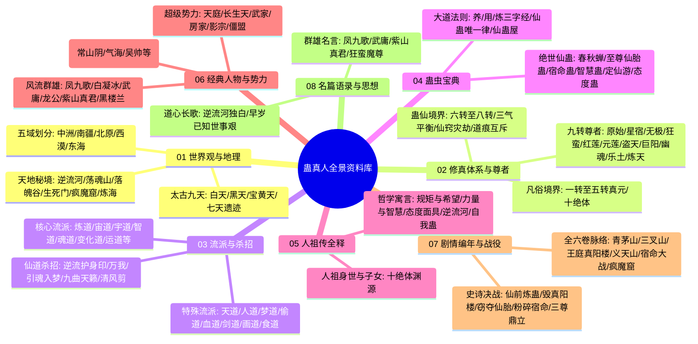

# 《蛊真人》全景式百科全书与深度资料汇编

> **“蛊是天地之精，人是万物之灵。朝闻道，夕死可矣。”**  
> 本资料库汇聚了著名奇幻修真巨作《蛊真人》全书核心设定、世界观架构、修炼晋升体系、历代尊者、千百流派、绝世神蛊、《人祖传》哲学深意以及全六卷剧情战役详解。内容详实系统，条理分明，旨在打造全网最详尽的《蛊真人》百科典藏库。

---

## 📚 资料库知识网络与导航目录

---

## 🗂️ 目录与文件详细清单

| 篇章分类 | 文档名称与直达链接 | 核心内容概述 |
| :--- | :--- | :--- |
| **01 世界观与地理格局** | [01_五域与九天.md](file:///c:/Users/12074/Documents/A_code/%E5%8F%8D%E9%87%8D%E5%8A%9B-%E8%9B%8A%E7%9C%9F%E4%BA%BA%E8%B5%84%E6%96%99/01_%E4%B8%96%E7%95%8C%E8%A7%82%E4%B8%8E%E5%9C%B0%E7%90%86%E6%A0%BC%E5%B1%80/%E4%BA%94%E5%9F%9F%E4%B8%8E%E4%B9%9D%E5%A4%A9.md) | 中洲门派、南疆山寨、北原部落、西漠绿洲、东海海阀；太古九天变迁、五域界壁消融与宝黄天机制。 |
|  | [02_天地秘境汇考.md](file:///c:/Users/12074/Documents/A_code/%E5%8F%8D%E9%87%8D%E5%8A%9B-%E8%9B%8A%E7%9C%9F%E4%BA%BA%E8%B5%84%E6%96%99/01_%E4%B8%96%E7%95%8C%E8%A7%82%E4%B8%8E%E5%9C%B0%E7%90%86%E6%A0%BC%E5%B1%80/%E5%A4%A9%E5%9C%B0%E7%A7%98%E5%A2%83%E6%B1%87%E8%80%83.md) | 荡魂山、落魄谷、逆流河、生死门、宙河、市井、乾坤晶壁、疯魔窟、炼海等准九转秘境全解。 |
| **02 修真体系与境界** | [01_蛊师与蛊仙晋阶体系.md](file:///c:/Users/12074/Documents/A_code/%E5%8F%8D%E9%87%8D%E5%8A%9B-%E8%9B%8A%E7%9C%9F%E4%BA%BA%E8%B5%84%E6%96%99/02_%E4%BF%AE%E7%9C%9F%E4%BD%93%E7%B3%BB%E4%B8%8E%E5%A2%83%E7%95%8C/%E8%9B%8A%E5%B8%88%E4%B8%8E%E8%9B%8A%E4%BB%99%E6%99%8B%E9%98%B6%E4%BD%93%E7%B3%BB.md) | 一至五转真元颜色、甲乙丙丁与十绝体；破茧碎窍三气平衡、六至八转福地洞天、灾劫、仙僵与道痕互斥律。 |
|  | [02_历代九转尊者全传.md](file:///c:/Users/12074/Documents/A_code/%E5%8F%8D%E9%87%8D%E5%8A%9B-%E8%9B%8A%E7%9C%9F%E4%BA%BA%E8%B5%84%E6%96%99/02_%E4%BF%AE%E7%9C%9F%E4%BD%93%E7%B3%BB%E4%B8%8E%E5%A2%83%E7%95%8C/%E5%8E%86%E4%BB%A3%E4%B9%9D%E8%BD%AC%E5%B0%8A%E8%80%85%E5%85%A8%E4%BC%A0.md) | 原始、星宿、无极、狂蛮、红莲、元莲、盗天、巨阳、幽魂、乐土、炼天魔尊方源等十一位尊者本纪与战史。 |
| **03 流派与杀招体系** | [01_三千流派大统考.md](file:///c:/Users/12074/Documents/A_code/%E5%8F%8D%E9%87%8D%E5%8A%9B-%E8%9B%8A%E7%9C%9F%E4%BA%BA%E8%B5%84%E6%96%99/03_%E6%B5%81%E6%B4%BE%E4%B8%8E%E6%9D%80%E6%8B%9B%E4%BD%93%E7%B3%BB/%E4%B8%89%E5%8D%83%E6%B5%81%E6%B4%BE%E5%A4%A7%E7%BB%9F%E8%80%83.md) | 炼道、宙道、宇道、智道、魂道等主流大派；天道、人道、梦道、偷道、血道、剑道等奇特流派全维度对比。 |
|  | [02_经典仙道杀招合辑.md](file:///c:/Users/12074/Documents/A_code/%E5%8F%8D%E9%87%8D%E5%8A%9B-%E8%9B%8A%E7%9C%9F%E4%BA%BA%E8%B5%84%E6%96%99/03_%E6%B5%81%E6%B4%BE%E4%B8%8E%E6%9D%80%E6%8B%9B%E4%BD%93%E7%B3%BB/%E7%BB%8F%E5%85%B8%E4%BB%99%E9%81%93%E6%9D%80%E6%8B%9B%E5%90%88%E8%BE%91.md) | 逆流护身印、万我、引魂入梦、鬼官遮天；凤九歌九曲天籁（命运歌）、武庸风声鹤唳、龙公九转归虚。 |
| **04 蛊虫宝典** | [01_经典与绝世仙蛊录.md](file:///c:/Users/12074/Documents/A_code/%E5%8F%8D%E9%87%8D%E5%8A%9B-%E8%9B%8A%E7%9C%9F%E4%BA%BA%E8%B5%84%E6%96%99/04_%E8%9B%8A%E8%99%AB%E5%AE%9D%E5%85%B8/%E7%BB%8F%E5%85%B8%E4%B8%8E%E7%BB%9D%E4%B8%96%E4%BB%99%E8%9B%8A%E5%BD%95.md) | 春秋蝉、九转至尊仙胎蛊、九转宿命蛊、九转智慧蛊、定仙游、态度蛊、爱蛊、坚持蛊等绝代神物深度拆解。 |
|  | [02_养用炼大道法则.md](file:///c:/Users/12074/Documents/A_code/%E5%8F%8D%E9%87%8D%E5%8A%9B-%E8%9B%8A%E7%9C%9F%E4%BA%BA%E8%B5%84%E6%96%99/04_%E8%9B%8A%E8%99%AB%E5%AE%9D%E5%85%B8/%E5%85%BB%E7%94%A8%E7%82%BC%E5%A4%A7%E9%81%93%E6%B3%95%E5%88%99.md) | 仙蛊口粮与仙窍经济危机；仙道杀招组构；仙蛊屋移动堡垒；隔离流派与精细流派两大炼法。 |
| **05 人祖传全释** | [01_人祖传故事编年与哲学解析.md](file:///c:/Users/12074/Documents/A_code/%E5%8F%8D%E9%87%8D%E5%8A%9B-%E8%9B%8A%E7%9C%9F%E4%BA%BA%E8%B5%84%E6%96%99/05_%E4%BA%BA%E7%A5%96%E4%BC%A0%E5%85%A8%E9%87%8A/%E4%BA%BA%E7%A5%96%E4%BC%A0%E6%95%85%E4%BA%8B%E7%BC%96%E5%B9%B4%E4%B8%8E%E5%93%B2%E5%AD%A6%E8%A7%A3%E6%9E%90.md) | 贯穿全书的哲学寓言总纲。人祖十子与十绝体；规矩与希望、力量与智慧的代价、态度的面具、逆流河、自我蛊。 |
| **06 经典人物与势力** | [01_古月方源全档案与马甲志.md](file:///c:/Users/12074/Documents/A_code/%E5%8F%8D%E9%87%8D%E5%8A%9B-%E8%9B%8A%E7%9C%9F%E4%BA%BA%E8%B5%84%E6%96%99/06_%E7%BB%8F%E5%85%B8%E4%BA%BA%E7%89%A9%E4%B8%8E%E5%8A%BF%E5%8A%9B/%E5%8F%A4%E6%9C%88%E6%96%B9%E6%BA%90%E5%85%A8%E6%A1%A3%E6%A1%88%E4%B8%8E%E9%A9%AC%E7%94%B2%E5%BF%97.md) | 主角方源档案：求道永生、万物刍狗道心；狼王常山阴、气海老祖、吴帅、梦求真、大爱仙尊等马甲分身全纪实。 |
|  | [02_风流人物谱.md](file:///c:/Users/12074/Documents/A_code/%E5%8F%8D%E9%87%8D%E5%8A%9B-%E8%9B%8A%E7%9C%9F%E4%BA%BA%E8%B5%84%E6%96%99/06_%E7%BB%8F%E5%85%B8%E4%BA%BA%E7%89%A9%E4%B8%8E%E5%8A%BF%E5%8A%9B/%E9%A3%8E%E6%B5%81%E4%BA%BA%E7%89%A9%E8%B0%B1.md) | 凤九歌、白凝冰、武庸、龙公、紫山真君、黑楼兰等天下英豪的性情、战绩与宿命悲欢。 |
|  | [03_五域各大超级势力.md](file:///c:/Users/12074/Documents/A_code/%E5%8F%8D%E9%87%8D%E5%8A%9B-%E8%9B%8A%E7%9C%9F%E4%BA%BA%E8%B5%84%E6%96%99/06_%E7%BB%8F%E5%85%B8%E4%BA%BA%E7%89%A9%E4%B8%8E%E5%8A%BF%E5%8A%9B/%E4%BA%94%E5%9F%9F%E5%90%84%E5%A4%A7%E8%B6%85%E7%BA%A7%E5%8A%BF%E5%8A%9B.md) | 中洲天庭与十大古派、北原长生天黄金家族、南疆武家/铁家/商家、西漠房家、东海异人盟、影宗与僵盟。 |
| **07 剧情编年与战役** | [01_全六卷主线剧情脉络.md](file:///c:/Users/12074/Documents/A_code/%E5%8F%8D%E9%87%8D%E5%8A%9B-%E8%9B%8A%E7%9C%9F%E4%BA%BA%E8%B5%84%E6%96%99/07_%E5%89%A7%E6%83%85%E7%BC%96%E5%B9%B4%E4%B8%8E%E6%88%98%E5%BD%B9/%E5%85%A8%E5%85%AD%E5%8D%B7%E4%B8%BB%E7%BA%BF%E5%89%A7%E6%83%85%E8%84%89%E7%BB%9C.md) | 第一卷到第六卷（青茅山到疯魔窟停更）共2334章主线超详细脉络归纳与关键转折点。 |
|  | [02_史诗战役详解.md](file:///c:/Users/12074/Documents/A_code/%E5%8F%8D%E9%87%8D%E5%8A%9B-%E8%9B%8A%E7%9C%9F%E4%BA%BA%E8%B5%84%E6%96%99/07_%E5%89%A7%E6%83%85%E7%BC%96%E5%B9%B4%E4%B8%8E%E6%88%98%E5%BD%B9/%E5%8F%B2%E8%AF%97%E6%88%98%E5%BD%B9%E8%AF%A6%E8%A7%A3.md) | 青茅山突围、三叉山仙前炼定仙游、八十八角真阳楼倾覆、义天山截胡至尊仙胎、天庭宿命决战、疯魔窟三尊对峙。 |
|  | [03_全剧情完整时间线编年史.md](file:///c:/Users/12074/Documents/A_code/%E5%8F%8D%E9%87%8D%E5%8A%9B-%E8%9B%8A%E7%9C%9F%E4%BA%BA%E8%B5%84%E6%96%99/07_%E5%89%A7%E6%83%85%E7%BC%96%E5%B9%B4%E4%B8%8E%E6%88%98%E5%BD%B9/%E5%85%A8%E5%89%A7%E6%83%85%E5%AE%8C%E6%95%B4%E6%97%B6%E9%97%B4%E7%BA%BF%E7%BC%96%E5%B9%B4%E5%8F%B2.md) | 【典藏纯文字版】远古人祖与十尊三百万年历史、前世五百年流亡、重生后正文逐年大事记、春秋蝉5次回溯全对照。 |
| **08 名篇语录与思想** | [01_经典语录与名场面辑录.md](file:///c:/Users/12074/Documents/A_code/%E5%8F%8D%E9%87%8D%E5%8A%9B-%E8%9B%8A%E7%9C%9F%E4%BA%BA%E8%B5%84%E6%96%99/08_%E5%90%8D%E7%AF%87%E8%AF%AD%E5%BD%95%E4%B8%8E%E6%80%9D%E6%83%B3/%E7%BB%8F%E5%85%B8%E8%AF%AD%E5%BD%95%E4%B8%8E%E5%90%8D%E5%9C%BA%E9%9D%A2%E8%BE%91%E5%BD%95.md) | 《逆流河长歌》、“早岁已知世事艰”、“便一去不回”、“郁郁久居人下”、狂蛮真男人哲学等传世篇章。 |
| **09 多维交叉考证与全景矩阵** | [01_全书核心要素多维交叉矩阵.md](file:///c:/Users/12074/Documents/A_code/%E5%8F%8D%E9%87%8D%E5%8A%9B-%E8%9B%8A%E7%9C%9F%E4%BA%BA%E8%B5%84%E6%96%99/09_%E5%A4%9A%E7%BB%B4%E4%BA%A4%E5%8F%89%E8%80%83%E8%AF%81%E4%B8%8E%E5%85%A8%E6%99%AF%E7%9F%A9%E9%98%B5/%E5%85%A8%E4%B9%A6%E6%A0%B8%E5%BF%83%E8%A6%81%E7%B4%A0%E5%A4%9A%E7%BB%B4%E4%BA%A4%E5%8F%89%E7%9F%A9%E9%98%B5.md) | 【核心矩阵】尊者-流派-仙蛊-秘境全要素考证表；人祖十子与十绝体映射表；五域地缘政治与界壁克制表；天意vs宿命vs春秋蝉因果博弈表。 |
|  | [02_仙蛊屋与战争兵器汇纂.md](file:///c:/Users/12074/Documents/A_code/%E5%8F%8D%E9%87%8D%E5%8A%9B-%E8%9B%8A%E7%9C%9F%E4%BA%BA%E8%B5%84%E6%96%99/09_%E5%A4%9A%E7%BB%B4%E4%BA%A4%E5%8F%89%E8%80%83%E8%AF%81%E4%B8%8E%E5%85%A8%E6%99%AF%E7%9F%A9%E9%98%B5/%E4%BB%99%E8%9B%8A%E5%B1%8B%E4%B8%8E%E6%88%98%E4%BA%89%E5%85%B5%E5%99%A8%E6%B1%87%E7%BA%82.md) | 监天塔、八十八角真阳楼、镇运天宫、龙宫、玉清滴风小竹楼、万年斗飞车、问津坞等九转/八转仙道核武器剖析。 |
|  | [03_至尊仙窍微观生态全景图.md](file:///c:/Users/12074/Documents/A_code/%E5%8F%8D%E9%87%8D%E5%8A%9B-%E8%9B%8A%E7%9C%9F%E4%BA%BA%E8%B5%84%E6%96%99/09_%E5%A4%9A%E7%BB%B4%E4%BA%A4%E5%8F%89%E8%80%83%E8%AF%81%E4%B8%8E%E5%85%A8%E6%99%AF%E7%9F%A9%E9%98%B5/%E8%87%B3%E5%B0%8A%E4%BB%99%E7%AA%8D%E5%BE%AE%E8%A7%82%E7%94%9F%E6%80%81%E5%85%A8%E6%99%AF%E5%9B%BE.md) | 小五域小九天道痕分布；荡魂山、落魄谷、炼海、人海安放点；毛民、石人、雪人、鲛人七大异人民族工业分工与经济内循环。 |

---

## 💡 特色与设计理念

1. **结构严谨**：严格依照原著2334章内容梳理，去除同人臆造，还原作者蛊真人的纯正设定。
2. **图表并茂**：大量采用 Mermaid 流程图、时序图、类图与结构脑图，将错综复杂的人物、境界、秘境关系直观呈现。
3. **哲学深挖**：不局限于爽文升级，重点剖析《人祖传》的隐喻、天意与宿命的抗争、纯粹求道者的心路历程。

