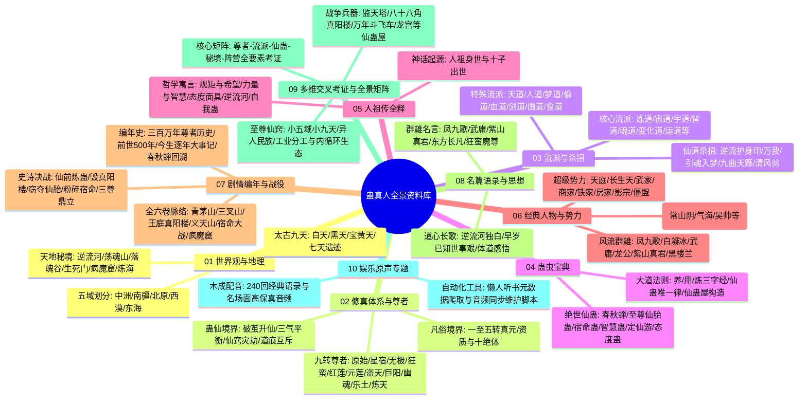
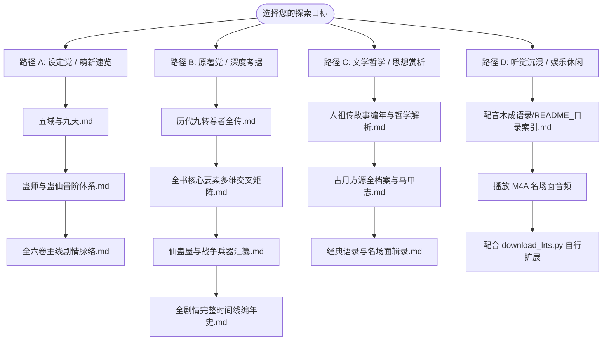

# 《蛊真人》全景式百科全书与深度资料典藏库

<div align="center">

> **“蛊是天地之精，人是万物之灵。朝闻道，夕死可矣。”**  
> **“早岁已知世事艰，大坂长青步步攀。君本凌云绝顶客，岂为蝼蚁作悲欢！”**

[](#)
[](#)
[](#audio-collection)
[](#)
[](#)

</div>

---

## 📖 项目简介 (Overview)

本资料库汇聚了著名奇幻修真巨作**《蛊真人》**全书的核心设定、宏大世界观架构、严密修炼晋升法则、历代九转尊者全传、千百流派杀招体系、《人祖传》哲学深意、全剧情编年史以及多维交叉考证矩阵。同时收录了**240回木成配音名场面音频语录**与自动化管理工具。

内容全景详实，条理清晰严谨，无同人臆造，旨在为蛊友、原著研究者、同人创作者与奇幻修真爱好者打造**全网最权威、最详尽的《蛊真人》百科典藏库**。

---

## 📚 资料库知识网络脑图 (Mindmap)



---

## 🗂️ 目录架构与文件树 (Directory Structure)

```text
反重力-蛊真人资料/
├── README.md                                      # 资料库全景总览与导航指引（本文档）
├── download_lrts.py                               # 懒人听书音频与元数据自动下载维护脚本
│
├── 01_世界观与地理格局/
│   ├── 五域与九天.md                              # 五域政治制度、地理风貌、界壁机制与太古九天变迁
│   └── 天地秘境汇考.md                            # 逆流河、荡魂山、落魄谷、生死门、疯魔窟等准九转秘境全解
│
├── 02_修真体系与境界/
│   ├── 蛊师与蛊仙晋阶体系.md                      # 一至五转真元资质、破茧三气平衡、福地洞天灾劫与道痕互斥律
│   └── 历代九转尊者全传.md                        # 十一位九转尊者生平本纪、时代背景、道统后手与终局对峙
│
├── 03_流派与杀招体系/
│   ├── 三千流派大统考.md                          # 常见大流派与罕见流派(天道/梦道/人道/偷道/运道等)全景剖析
│   └── 经典仙道杀招合辑.md                        # 逆流护身印、万我、命运歌、引魂入梦等震古烁今杀招解构
│
├── 04_蛊虫宝典/
│   ├── 经典与绝世仙蛊录.md                        # 春秋蝉、至尊仙胎蛊、宿命蛊、智慧蛊、定仙游等九转/八转仙蛊
│   └── 养用炼大道法则.md                          # 仙蛊唯一律、仙窍经济与口粮危机、仙蛊屋架构、毛民与隔绝炼法
│
├── 05_人祖传全释/
│   └── 人祖传故事编年与哲学解析.md                # 贯穿全书的哲学总纲：人祖十子起源、神话隐喻与人生三重境界
│
├── 06_经典人物与势力/
│   ├── 古月方源全档案与马甲志.md                  # 主角求道永生道心、五百年阅历、分身马甲全纪实
│   ├── 风流人物谱.md                              # 凤九歌、白凝冰、武庸、龙公、紫山真君等群雄生平与性情
│   └── 五域各大超级势力.md                        # 中洲天庭与十大古派、长生天、武家、商家、房家、影宗等
│
├── 07_剧情编年与战役/
│   ├── 全六卷主线剧情脉络.md                      # 全书第1卷至第6卷（青茅山到疯魔窟）共2334章完整主线梳理
│   ├── 史诗战役详解.md                            # 三叉山炼仙蛊、真阳楼倾覆、义天山截胡、宿命决战等惊天转折
│   └── 全剧情完整时间线编年史.md                  # 【典藏纯文字版】300万年尊者史、前世500年、正文逐年大事记
│
├── 08_名篇语录与思想/
│   └── 经典语录与名场面辑录.md                    # 《逆流河长歌》、“早岁已知世事艰”、“便一去不回”等传世篇章
│
├── 09_多维交叉考证与全景矩阵/
│   ├── 全书核心要素多维交叉矩阵.md                # 尊者流派仙蛊大对照、十绝体映射、界壁克制、宿命因果博弈
│   ├── 仙蛊屋与战争兵器汇纂.md                    # 监天塔、八十八角真阳楼、龙宫、镇运天宫等仙道战争堡垒
│   └── 至尊仙窍微观生态全景图.md                  # 小五域小九天道痕、秘境安放点、异人民族分工与经济内循环
│
└── 蛊真人_配音木成语录(娱乐篇)/
    ├── README_目录索引.md                         # 240回木成配音名场面与经典语录完整清单导览
    ├── metadata.json                              # 240回完整音频元数据（标题、时长、大小、ID）
    └── *.m4a                                      # 240个高品质 AAC 音频片段（共 124.76 MB）
```

---

## 📑 核心文献分类索引与深度导读

> [!TIP]
> 文档中包含大量 **Mermaid 图表** 与 **交叉数据表**，建议使用支持 Markdown 渲染的现代编辑器（如 VS Code、Obsidian、GitHub 等）阅读以获得最佳排版体验。

### 01 世界观与地理格局

| 文档名称 | 核心内容概述 | 关键要素标签 |
| :--- | :--- | :--- |
| 📍 [五域与九天.md](./01_世界观与地理格局/五域与九天.md) | 深度拆解中洲门派制、南疆山寨制、北原部落制、西漠家族绿洲、东海海阀；分析五域界壁排斥与消融机制、太古九天演变。 | `五域界壁` `太古九天` `天庭` `长生天` `宝黄天` |
| 🏔️ [天地秘境汇考.md](./01_世界观与地理格局/天地秘境汇考.md) | 全景汇编逆流河、荡魂山、落魄谷、生死门、宙河、市井、疯魔窟、炼海、人海等准九转天地秘境的自然规则与战略价值。 | `逆流河` `荡魂山` `落魄谷` `生死门` `疯魔窟` `炼海` |

---

### 02 修真体系与尊者本纪

| 文档名称 | 核心内容概述 | 关键要素标签 |
| :--- | :--- | :--- |
| ⚡ [蛊师与蛊仙晋阶体系.md](./02_修真体系与境界/蛊师与蛊仙晋阶体系.md) | 一转至五转空窍真元与十绝体；碎窍破茧三气平衡（天/地/人）、福地洞天经营、天劫地灾万劫、仙僵弊端与道痕互斥法则。 | `真元晋阶` `三气平衡` `灾劫机制` `仙僵转化` `道痕互斥` |
| 👑 [历代九转尊者全传.md](./02_修真体系与境界/历代九转尊者全传.md) | 原始、星宿、无极、狂蛮、红莲、元莲、盗天、巨阳、幽魂、乐土、炼天魔尊（方源）十一位九转尊者生平史诗、流派道统与万古布局。 | `三大魔尊` `天庭三尊` `巨阳仙尊` `炼天魔尊` `疯魔窟对决` |

---

### 03 流派与杀招体系

| 文档名称 | 核心内容概述 | 关键要素标签 |
| :--- | :--- | :--- |
| 🌀 [三千流派大统考.md](./03_流派与杀招体系/三千流派大统考.md) | 详尽剖析炼道、宙道、宇道、智道、魂道等主流大派；深度解构天道、人道、梦道、偷道、血道、剑道、画道、食道等奇门绝学。 | `全流派考证` `天道` `梦道` `偷道` `血道` `食道` |
| ⚔️ [经典仙道杀招合辑.md](./03_流派与杀招体系/经典仙道杀招合辑.md) | 逆流护身印、万我、引魂入梦、鬼官遮天、九转归虚，以及凤九歌九曲天籁（命运歌）、武庸风声鹤唳等神级杀招构造原理。 | `逆流护身印` `万我` `引魂入梦` `命运歌` `风声鹤唳` |

---

### 04 蛊虫宝典与至宝

| 文档名称 | 核心内容概述 | 关键要素标签 |
| :--- | :--- | :--- |
| 🦗 [经典与绝世仙蛊录.md](./04_蛊虫宝典/经典与绝世仙蛊录.md) | 春秋蝉、九转至尊仙胎蛊、九转宿命蛊、九转智慧蛊、定仙游、态度蛊、爱蛊、坚持蛊等绝代神物威能与流转机缘考证。 | `春秋蝉` `至尊仙胎蛊` `宿命蛊` `智慧蛊` `定仙游` |
| ⚗️ [养用炼大道法则.md](./04_蛊虫宝典/养用炼大道法则.md) | 蛊道三大核心“养蛊、用蛊、炼蛊”天道规律；仙蛊喂养口粮危机、仙蛊屋移动堡垒结构；毛民天地炼法与人族隔绝炼法全景对比。 | `仙蛊唯一` `仙窍经济` `仙蛊屋` `隔绝流` `毛民天地法` |

---

### 05 人祖传全释与哲学

| 文档名称 | 核心内容概述 | 关键要素标签 |
| :--- | :--- | :--- |
| 📜 [人祖传故事编年与哲学解析.md](./05_人祖传全释/人祖传故事编年与哲学解析.md) | 贯穿全书的哲学寓言总纲。人祖身世与十子出世；规矩与希望、力量与智慧的代价、态度的面具、逆流河艰难跋涉、自我蛊的真谛。 | `人祖十子` `希望蛊` `态度面具` `逆流河` `自我蛊` |

---

### 06 经典人物与五域势力

| 文档名称 | 核心内容概述 | 关键要素标签 |
| :--- | :--- | :--- |
| 👤 [古月方源全档案与马甲志.md](./06_经典人物与势力/古月方源全档案与马甲志.md) | 主角方源档案：求道永生道心、天地刍狗心境；狼王常山阴、气海老祖、吴帅、梦求真、大爱仙尊等全身份马甲纪实。 | `古月方源` `大爱仙尊` `气海老祖` `常山阴` `吴帅` |
| 🌟 [风流人物谱.md](./06_经典人物与势力/风流人物谱.md) | 凤九歌（红尘情义）、白凝冰（纯粹精彩）、武庸（枭雄本色）、龙公（天庭脊梁）、紫山真君（传承绝唱）等群雄志。 | `凤九歌` `白凝冰` `武庸` `龙公` `紫山真君` `黑楼兰` |
| 🏛️ [五域各大超级势力.md](./06_经典人物与势力/五域各大超级势力.md) | 中洲天庭与十大古派、北原长生天黄金家族、南疆武家/铁家/商家、西漠房家、东海异人盟、影宗与僵盟组织架构与兴衰史。 | `天庭` `长生天` `武家` `商家` `房家` `影宗` |

---

### 07 剧情编年与史诗战役

| 文档名称 | 核心内容概述 | 关键要素标签 |
| :--- | :--- | :--- |
| 📖 [全六卷主线剧情脉络.md](./07_剧情编年与战役/全六卷主线剧情脉络.md) | 第一卷青茅山魔头到第六卷疯魔窟永生对峙共2334章完整主线梳理，标注各大卷核心矛盾与转折点。 | `全六卷` `2334章` `青茅山` `真阳楼` `宿命大战` |
| 🔥 [史诗战役详解.md](./07_剧情编年与战役/史诗战役详解.md) | 青茅山狼潮突围、三叉山仙前炼定仙游、八十八角真阳楼坍塌、义天山至尊仙胎截胡、宿命蛊终极决战、疯魔窟三尊博弈。 | `仙前炼蛊` `毁真阳楼` `窃夺仙胎` `宿命决战` `疯魔之战` |
| ⏳ [全剧情完整时间线编年史.md](./07_剧情编年与战役/全剧情完整时间线编年史.md) | 【典藏纯文字版】远古人祖时代、十代尊者三百万年历史、方源前世五百年流亡、重生后正文逐年大事记、春秋蝉5次重大回溯全对照。 | `300万年通史` `前世500年` `今生大事记` `春秋蝉5次回溯` |

---

### 08 名篇语录与思想

| 文档名称 | 核心内容概述 | 关键要素标签 |
| :--- | :--- | :--- |
| 💬 [经典语录与名场面辑录.md](./08_名篇语录与思想/经典语录与名场面辑录.md) | 《逆流河长歌》、“早岁已知世事艰”、“便一去不回”、“郁郁久居人下”、狂蛮魔尊“真男人哲学”、凤九歌天地留音等传世名篇金句。 | `逆流河长歌` `早岁已知世事艰` `便一去不回` `狂蛮语录` |

---

### 09 多维交叉考证与全景矩阵

| 文档名称 | 核心内容概述 | 关键要素标签 |
| :--- | :--- | :--- |
| 🧬 [全书核心要素多维交叉矩阵.md](./09_多维交叉考证与全景矩阵/全书核心要素多维交叉矩阵.md) | 【核心矩阵】尊者-流派-仙蛊-秘境-阵营全要素考证表；人祖十子与十绝体映射表；五域地缘政治与界壁克制表；天意vs宿命vs春秋蝉因果博弈表。 | `尊者全要素表` `十绝体映射` `五域界壁克制` `因果博弈` |
| 🏰 [仙蛊屋与战争兵器汇纂.md](./09_多维交叉考证与全景矩阵/仙蛊屋与战争兵器汇纂.md) | 监天塔、八十八角真阳楼、镇运天宫、龙宫、玉清滴风小竹楼、万年斗飞车、问津坞等九转/八转仙道战争兵器机制与攻防参数解析。 | `监天塔` `真阳楼` `镇运天宫` `龙宫` `仙蛊屋参数` |
| 🌐 [至尊仙窍微观生态全景图.md](./09_多维交叉考证与全景矩阵/至尊仙窍微观生态全景图.md) | 小五域小九天道痕分布；荡魂山、落魄谷、炼海、人海安放点；毛民、石人、雪人、鲛人七大异人民族工业分工与经济内循环模型。 | `至尊仙窍` `小五域小九天` `异人分工` `仙窍内循环` |

---

<span id="audio-collection"></span>

## 🎧 特别收录：木成配音《蛊真人/大爱仙尊》语录合辑（娱乐篇）

在文字资料库之外，本项目独家整理并归档了网络广为流传的著名配音主播**木成（一转名声蛊）**倾情演播的《蛊真人/大爱仙尊》名场面与搞笑名梗音频合辑：

- **音频总集数**：**240 回完整版**
- **音频格式**：M4A (AAC 高保真音频，体积 124.76 MB)
- **专题目录索引**：👉 [蛊真人_配音木成语录(娱乐篇)/README_目录索引.md](<./蛊真人_配音木成语录(娱乐篇)/README_目录索引.md>)
- **元数据配置文件**：[`./蛊真人_配音木成语录(娱乐篇)/metadata.json`](<./蛊真人_配音木成语录(娱乐篇)/metadata.json>)
- **下载与维护脚本**：[`./download_lrts.py`](./download_lrts.py)（支持断点续传与元数据缓存）

### 🔥 部分高光篇章推荐

| 编号 | 章节标题 | 时长 | 亮点主题 |
| :---: | :--- | :---: | :--- |
| **001** | 五块半元石 | 01:35 | 经典开局：商队老帮菜与青茅山少年方源的元石算计 |
| **003** | 方源朗声一笑 | 01:07 | 霸气无匹：魔道巨擘的豪迈笑声与道心独白 |
| **010** | 全书我只看到了坚持二字 | 01:27 | 哲学升华：逆流河上坚持蛊的真谛 |
| **014** | 三气归来 我龙公绝对不能倒下 | 02:40 | 史诗高燃：天庭柱石龙公九转归虚前的最后冲锋 |
| **026** | 武庸不庸 长凡不凡 | 01:07 | 枭雄史诗：南疆武庸与智道东方长凡的风采 |
| **037** | 恭送紫山真君大人 | 02:03 | 影宗绝唱：紫山真君临终托孤方源，悲壮落幕 |
| **038** | 帅道无上大宗师狂蛮魔尊 | 02:02 | 原著整活：狂蛮魔尊“男人就要变大变硬变帅”的咆哮 |
| **044** | 方源点点头 原来你也玩源神 | 02:03 | 蛊界热梗：大爱仙尊跨界整活名场面 |
| **237** | 二十七步天注定 逆流河上任我行 | 01:42 | 高潮顶点：方源逆流河孤身前行，“不过是些许风霜罢了” |

---

## 📊 核心考证精要速览 (Quick Reference)

### 1. 十一代九转尊者全览

```text
太古时代 ──> 远古时代 ──────> 中古时代 ──────> 近古时代 ──────> 当代/大梦时代
原始仙尊    无极魔尊(律道)    元莲仙尊(木/画)   幽魂魔尊(魂道)    炼天魔尊/方源(炼道/兼修)
(气道)      狂蛮魔尊(变/力)   盗天魔尊(偷/宇)   乐土仙尊(土/人)   星宿/巨阳/方源三尊并立
星宿仙尊    红莲魔尊(宙道)    巨阳仙尊(运道)
(智/星道)
```

| 尊号 | 阵营归属 | 主修/兼修流派 | 本命/代表仙蛊 | 核心战略秘境/仙蛊屋 | 关键布局与结局 |
| :--- | :--- | :--- | :--- | :--- | :--- |
| **原始仙尊** | 中洲·天庭 | 气道 | 气道核心蛊群 | 天庭气墙、浩瀚元气深潭 | 开创天庭，传位星宿，暗藏百万年气道浩然底蕴 |
| **星宿仙尊** | 中洲·天庭 | 智道 / 星道 | 智慧蛊、星念蛊 | 【仙蛊屋】飞星棋盘 | 以身合天道300万年影响天意，疯魔窟大战率先复生 |
| **无极魔尊** | 散修魔道始祖 | 律道 | 规矩蛊、排斥蛊 | 【天地秘境】疯魔窟 | 推演演化千万年追求永生，疯魔窟终局永生失败道消 |
| **狂蛮魔尊** | 散修无敌霸主 | 变化道 / 力道 | 变异蛊、力道绝品 | 狂蛮真传万兽图腾、吞天魔狼 | 轰碎太古赤橙黄三天，留下不朽图腾火种 |
| **红莲魔尊** | 天庭逆徒/反抗者 | 宙道 | 春秋蝉、岁月蛊 | 【天地秘境】宙河、石莲岛 | 千百次回溯重击宿命蛊一角，为方源彻底毁蛊埋下薪火 |
| **元莲仙尊** | 中洲·天莲派/天庭 | 木道 / 画道 | 帝君神木、画道仙蛊 | 【仙蛊屋】神帝天莲、画卷众生图 | 疯魔窟画卷展开，复活无数天庭英灵参战 |
| **盗天魔尊** | 异界天外之魔 | 偷道 / 宇道 | 偷天蛊、神不知鬼不觉 | 【仙蛊屋】空绝神甲、盗天机甲 | 追求打破晶壁回家，留方源神不知鬼不觉两大外挂 |
| **巨阳仙尊** | 北原·长生天 | 运道 | 自身运、众生运 | 【仙蛊屋】八十八角真阳楼、镇运天宫 | 黄金家族统领北原数万年，疯魔窟复生三足鼎立 |
| **幽魂魔尊** | 散修暗黑霸主/影宗 | 魂道 | 九转至尊仙胎蛊、噬魂蛊 | 【天地秘境】生死门、荡魂山、落魄谷 | 屠戮万灵以杀证道，十万年炼制仙胎被方源截胡夺舍 |
| **乐土仙尊** | 散修圣王 | 土道/人道/天道 | 功德蛊、大愿蛊 | 【天地秘境】南疆乐土、人海雏形 | 平抑天下杀劫未杀一生灵，疯魔窟转修天道被方源斩杀吸收 |
| **炼天魔尊** | 大爱盟/齐天洞天 | 炼道（九转）/万派 | 至尊仙胎蛊、春秋蝉、定仙游 | 【秘境】逆流河/荡魂山/落魄谷/炼海/人海 | 捏爆宿命蛊，疯魔窟斩乐土登临九转，化身“大爱仙尊” |

### 2. 人祖十子与十绝体对应速查

| 排行 | 人祖十子神话 | 现世十绝体 | 核心流派 | 代表原著人物 | 宿命结局与意义 |
| :---: | :--- | :--- | :--- | :--- | :--- |
| **长子** | 人祖左眼所化 | **太日阳莽体** | 宇道 / 光道 | 太日阳莽 / 影宗仙僵 | 狂傲自负，在生死门沉沦，因爱蛊而亡 |
| **次女** | 人祖右眼所化 | **古月阴荒体** | 宙道 / 月道 | 古月古祖 / 影无邪初代肉身 | 繁衍古月一族血脉，与长子相依为命 |
| **三子** | 人祖心智坚冰 | **北冥冰魄体** | 冰雪道 / 魂道 | **白凝冰** | 青茅山自爆冰封群山，追寻世间极致精彩 |
| **四女** | 人祖生命生机 | **森海轮回体** | 木道 / 生生道 | 森海仙僵 | 滔天生机恢复力，十绝仙僵大阵核心 |
| **五子** | 人祖怒火惊雷 | **炎煌雷泽体** | 炎道 / 雷道 | 炎煌仙僵 | 毁灭攻伐极强，炼制仙胎的雷炎火种 |
| **六女** | 人祖富贵华采 | **万金妙华体** | 金道 | 金晨曦仙僵 | 极尽锋锐华美，提供至尊仙胎金道底蕴 |
| **七子** | 人祖蛮力骨骼 | **大力真武体** | 力道 / 纯阳武道 | **黑楼兰** | 弑父复仇女扮男装，力大无穷，方源得力战将 |
| **八女** | 人祖机巧灵犀 | **逍遥智心体** | 智道 / 算计 | 智仙子仙僵 | 推演万物，为十绝仙僵大阵提供精妙运转 |
| **九子** | 人祖厚土承载 | **厚土元央体** | 土道 / 地脉 | 厚土仙僵 | 提供至尊仙窍稳定大地的根本载体 |
| **十子** | 人祖虚空衍生 | **宇宙大衍体** | 宇道 / 变化 | 虚空仙僵 | 赋予至尊仙胎包容万物、空间无垠之特性 |
| **【外篇】**| 影宗/方源研创 | **纯梦求真体** | **梦道**（未来至尊） | **梦求真**（方源梦道分身） | 免疫梦境同化，汲取天地梦境跃升全流派境界 |

---

## 🧭 建议阅读路径 (Reading Pathways)



- **路径 A【萌新与通识入门】**：从 [五域与九天.md](./01_世界观与地理格局/五域与九天.md) 开始，了解地理格局与门派制度；随后研读 [蛊师与蛊仙晋阶体系.md](./02_修真体系与境界/蛊师与蛊仙晋阶体系.md) 掌握修行阶梯；最后结合 [全六卷主线剧情脉络.md](./07_剧情编年与战役/全六卷主线剧情脉络.md) 建立全局观。
- **路径 B【老饕与深度考据】**：直奔 [全书核心要素多维交叉矩阵.md](./09_多维交叉考证与全景矩阵/全书核心要素多维交叉矩阵.md) 与 [历代九转尊者全传.md](./02_修真体系与境界/历代九转尊者全传.md) 剖析尊者万古博弈，参阅 [全剧情完整时间线编年史.md](./07_剧情编年与战役/全剧情完整时间线编年史.md) 对照三百万年编年史。
- **路径 C【文学与哲学赏析】**：必读 [人祖传故事编年与哲学解析.md](./05_人祖传全释/人祖传故事编年与哲学解析.md)，体会蛊真人借神话隐喻人生的深沉笔力，重温 [经典语录与名场面辑录.md](./08_名篇语录与思想/经典语录与名场面辑录.md) 中的《逆流河长歌》。
- **路径 D【听觉沉浸与娱乐】**：打开 [木成配音目录索引](<./蛊真人_配音木成语录(娱乐篇)/README_目录索引.md>)，一边聆听高保真配音音频，一边对照文献重温经典桥段。

---

## 🛠️ 维护与技术说明 (Maintenance)

1. **相对路径兼容性**：全库所有文档超链接统一采用标准相对路径格式（如 `./目录/文档.md`），全面支持 GitHub Web 端、VS Code、Obsidian、Typora 及跨平台文件系统直接点击导航跳转。
2. **图表渲染标准**：所有图表均基于标准 **Mermaid** 语法（`graph` / `mindmap` / `flowchart`）编写，确保在支持 Markdown 的各大阅读环境中即时可视化渲染。
3. **文本编码标准**：全库 Markdown 与 JSON 文本文件均严格采用 **UTF-8（无 BOM）** 编码存储，杜绝跨系统展示乱码。
4. **音频管理脚本**：根目录下的 `download_lrts.py` 脚本包含懒人听书源接口调用、多线程并行下载、断点续传及 `metadata.json` 自动解析机制，可用于后续音源的补充与更新。

---

## ⚖️ 免责声明与版权提示 (Disclaimer)

1. **原著版权**：本资料库全部文字整理内容均基于作家**蛊真人**所著之网络小说《蛊真人》（又名《大爱仙尊》）。原著知识产权归原作者所有。
2. **音频版权**：语录配音素材归配音演播者**木成（一转名声蛊）**及原发布平台所有。
3. **开源非商业用途**：本资料库仅供个人学术研究、文学考据与修真世界观交流之用，严禁将本库任何内容用于商业盈利或非法牟利行为。

---

<div align="center">

**“这条路注定崎岖坎坷，但只要还有一口气在，便一去不回。”**  
*—— 愿所有怀揣理想的求道者，在自己的逆流河上，皆能迎风破浪！*

</div>
